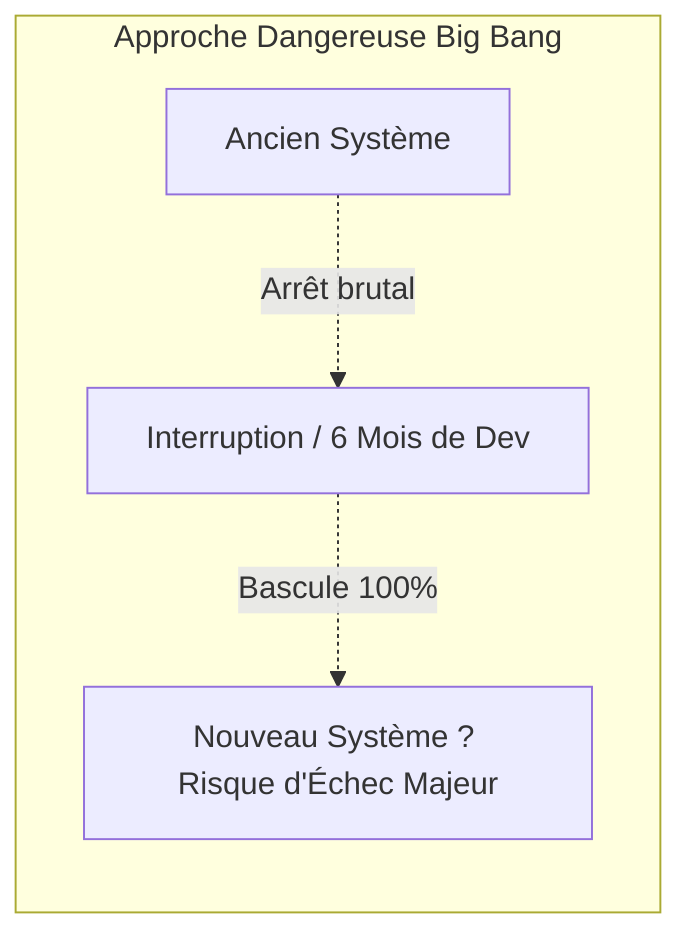
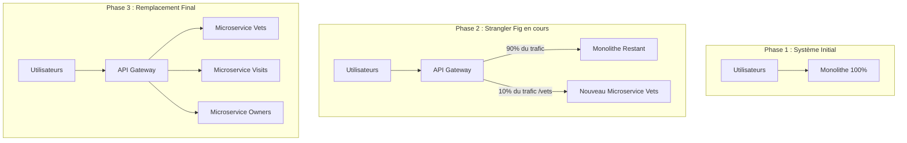
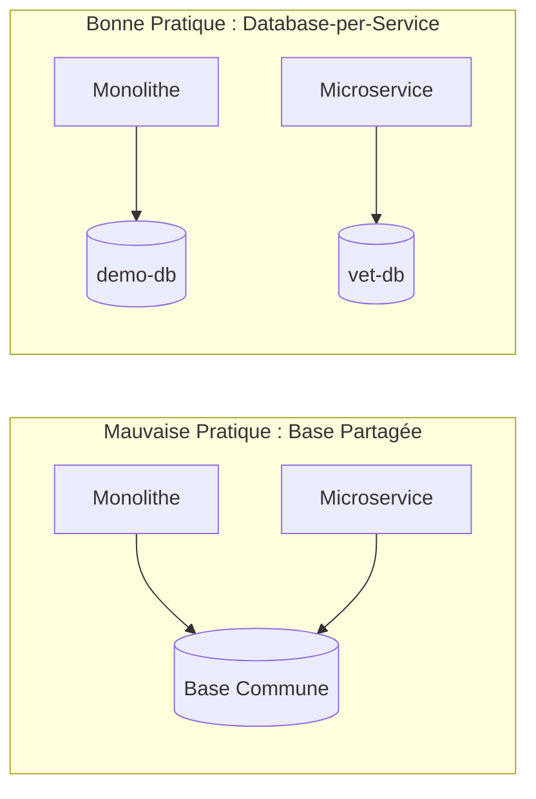
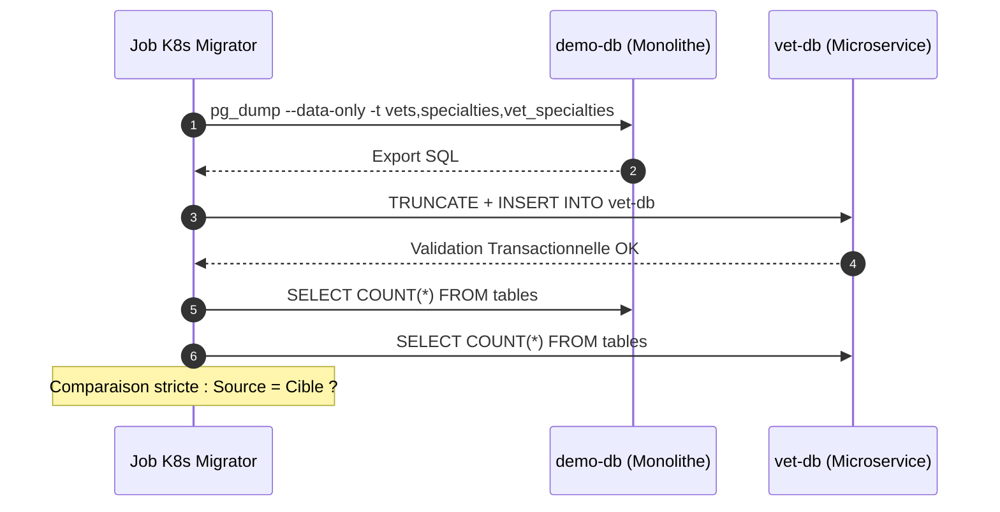
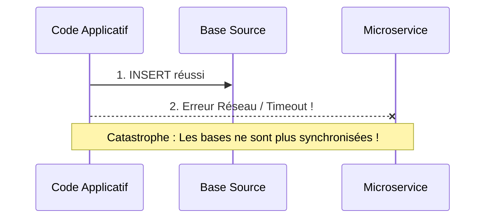
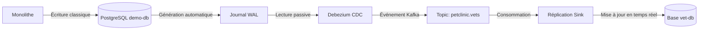
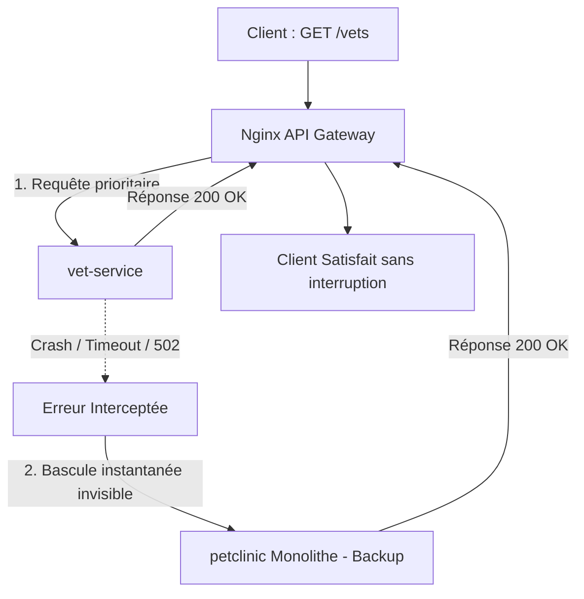

# Guide Complet d'Architecture : Migration d'un Monolithe vers les Microservices (Pattern Strangler Fig)

---

## Table des Matières
1. [Introduction & Contexte : Qu'est-ce que la Migration ?](#1-introduction--contexte--quest-ce-que-la-migration-)
2. [Pourquoi l'approche "Big Bang" échoue-t-elle ?](#2-pourquoi-lapproche-big-bang-échoue-t-elle-)
3. [Le Pattern Fondateur : "Strangler Fig" (Le Figuier Étrangleur)](#3-le-pattern-fondateur--strangler-fig-le-figuier-étrangleur)
4. [Architecture Globale Cible](#4-architecture-globale-cible)
5. [Étape par Étape : La Décomposition Pratique du Projet](#5-étape-par-étape--la-décomposition-pratique-du-projet)
   - [Étape 1 : Isoler un Périmètre Métier (Bounded Context)](#étape-1--isoler-un-périmètre-métier-bounded-context)
   - [Étape 2 : L'API Gateway, le Douanier du Réseau](#étape-2--lapi-gateway-le-douanier-du-réseau)
   - [Étape 3 : Le Découpage de la Donnée (Database-per-Service)](#étape-3--le-découpage-de-la-donnée-database-per-service)
   - [Étape 4 : La Migration des Données Historiques (Le Job One-Shot)](#étape-4--la-migration-des-données-historiques-le-job-one-shot)
   - [Étape 5 : La Synchronisation Continue et le Défi du "Dual Write" (CDC & Kafka)](#étape-5--la-synchronisation-continue-et-le-défi-du-dual-write-cdc--kafka)
   - [Étape 6 : Résilience Maximale et Sécurité Zéro-Downtime (Fallback Automatique)](#étape-6--résilience-maximale-et-sécurité-zéro-downtime-fallback-automatique)
6. [Catalogue des Problèmes Résolus et Pièges Évités](#6-catalogue-des-problèmes-résolus-et-pièges-évités)
7. [Glossaire pour Débutants](#7-glossaire-pour-débutants)

---

## 1. Introduction & Contexte : Qu'est-ce que la Migration ?

Dans le monde du logiciel d'entreprise :
* Un **Monolithe** est une application où tout le code (gestion des utilisateurs, catalogue, facturation, rapports) vit dans un seul et même bloc logiciel, partageant généralement une unique base de données.
* Une architecture en **Microservices** découpe ce gros bloc en plusieurs petits services indépendants. Chaque service s'occupe d'un seul métier précis, possède sa propre base de données, et communique avec les autres via le réseau.

Le projet qui sert de support ici illustre la transformation d'un monolithe vers une architecture distribuée, hébergée sur **Kubernetes**, en extrayant un premier service métier (`vet-service` : gestion des vétérinaires).

---

## 2. Pourquoi l'approche "Big Bang" échoue-t-elle ?

L'approche naïve, dite du **"Big Bang"**, consiste à dire :  
*"Nous allons arrêter le monolithe un week-end, réécrire toute l'application en microservices pendant 6 mois dans notre coin, puis basculer tous les utilisateurs d'un coup."*



### Les risques majeurs du Big Bang :
1. **L'effet tunnel** : Pendant 6 mois ou 1 an, aucune nouvelle fonctionnalité métier ne peut sortir.
2. **L'explosion en vol** : Le jour de la bascule, des dizaines de bugs imprévus surviennent simultanément. Le rollback (retour en arrière) est impossible ou catastrophique.
3. **Pertes de données** : Si la nouvelle base ne réagit pas comme l'ancienne, des écritures clients peuvent disparaître.

---

## 3. Le Pattern Fondateur : "Strangler Fig" (Le Figuier Étrangleur)

Pour éviter les dangers du Big Bang, l'industrie logicielle utilise la métaphore du **Figuier Étrangleur** (popularisée par Martin Fowler). Dans la nature, cet arbre prend racine au sommet d'un arbre hôte, descend lentement ses racines autour de son tronc, grandit progressivement et finit par remplacer l'arbre hôte sans qu'il n'y ait jamais de vide.

En informatique, cela signifie :
> **On ne détruit pas le monolithe.**  
> On place un routeur devant lui. Petit à petit, on extrait une fonctionnalité dans un microservice indépendant, on redirige une fraction du trafic vers ce microservice, et on répète l'opération jusqu'à ce que le monolithe disparaisse naturellement.



---

## 4. Architecture Globale Cible

Voici la cartographie des composants mis en place sur notre infrastructure :

```mermaid
graph TB
    Client([Navigateur Web / Client HTTP]) -->|Port 80/8080| Gateway[Nginx API Gateway]

    subgraph "Namespace gateway"
        Gateway
    end

    subgraph "Namespace microservices"
        VetSvc[vet-service <br/> Microservice REST]
        VetDB[(vet-db <br/> PostgreSQL Dédié)]
        VetSvc --> VetDB
    end

    subgraph "Namespace default (Monolithe)"
        Monolith[petclinic <br/> Monolithe Legacy]
        DemoDB[(demo-db <br/> PostgreSQL Monolithe)]
        Monolith --> DemoDB
    end

    subgraph "Namespace kafka (Synchronisation)"
        Debezium[Debezium CDC Connector]
        KafkaCluster[(Kafka Broker)]
        Debezium -. Lit le WAL .-> DemoDB
        Debezium -. Publie les events .-> KafkaCluster
        KafkaCluster -. Réplique en temps réel .-> VetDB
    end

    subgraph "Job One-Shot"
        Job[K8s Job: migrate-historical-vets]
        Job -. 1. Copie ponctuelle .-> DemoDB
        Job -. 2. Injection & Vérification .-> VetDB
    end

    %% Routage Gateway
    Gateway -->|1. Route /vets| VetSvc
    Gateway -->|2. Toutes les autres routes| Monolith
    Gateway -.->|3. Fallback automatique si panne| Monolith
```

---

## 5. Étape par Étape : La Décomposition Pratique du Projet

### Étape 1 : Isoler un Périmètre Métier (*Bounded Context*)
Dans notre application, nous identifions un domaine cohérent et avec peu de dépendances fortes : les **Vétérinaires** (`vets`, `specialties`, `vet_specialties`).  
* **Pourquoi ce domaine ?** Il est souvent lu, rarement modifié, et possède des frontières claires. C'est le candidat idéal pour valider le pipeline sans risque pour le cœur de métier (clients, paiements).

---

### Étape 2 : L'API Gateway, le Douanier du Réseau
Avant même de toucher au code, nous plaçons un composant central : une **API Gateway (Nginx)**.
* **Son rôle** : Être le seul point d'entrée exposé à l'extérieur. Les clients (navigateurs, applications mobiles) ne parlent qu'à elle.
* **Le principe d'aiguillage** :
  - Si l'URL commence par `/vets`, la Gateway l'envoie vers le nouveau microservice `vet-service`.
  - Toutes les autres requêtes (`/`, `/owners`, `/pets`) continuent d'aller vers l'ancien monolithe.
  - **Finesse technique** : La page `/vets.html` (rendu HTML graphique de l'ancien monolithe) est conservée sur le monolithe. Seule l'API REST JSON `/vets` est envoyée au microservice. L'utilisateur ne voit aucune différence.

---

### Étape 3 : Le Découpage de la Donnée (*Database-per-Service*)
Une règle absolue des microservices : **Un microservice ne doit JAMAIS lire ou écrire directement dans la base de données d'un autre service.**
* Si le microservice accédait à la base du monolithe :
  - Toute modification de table casserait les deux systèmes.
  - Un bug ou une requête lente du microservice bloquerait la base du monolithe.
* **Ce qui a été fait** : Création d'une base dédiée `vet-db` dans le namespace `microservices`, avec son propre compte, mot de passe et stockage persistant PVC.



---

### Étape 4 : La Migration des Données Historiques (Le Job One-Shot)
La nouvelle base de données `vet-db` naît vide. Il faut y injecter les données existantes de la base source `demo-db`.

* **Comment cela a été automatisé ?**
  Nous avons conçu un **Job Kubernetes** (`migrate-historical-data-job.yml`) qui s'exécute une seule fois :
  1. Il exécute un `pg_dump` ciblé uniquement sur les tables nécessaires (`vets`, `specialties`, `vet_specialties`).
  2. Il nettoie les directives de versions incompatibles (ex. `SET transaction_timeout`).
  3. Il applique les données sur `vet-db` à l'intérieur d'une transaction unique (`--single-transaction`).
  4. **Contrôle d'intégrité automatique** : Le job effectue un décompte comparé (`SELECT count(*)`) entre la base source et la base cible. Si les totaux ne sont pas strictement identiques, le job échoue pour empêcher d'activer un service bancal.



---

### Étape 5 : La Synchronisation Continue et le Défi du "Dual Write" (CDC & Kafka)

Que se passe-t-il si un utilisateur modifie un vétérinaire sur le monolithe pendant que nous testons le microservice ? La nouvelle base deviendrait obsolète.

#### Le Piège du "Dual Write" (Double Écriture applicative) :
Si on demandait au développeur : *"Écris dans la base monolithe ET écris en même temps dans l'API du microservice"*, voici ce qui arriverait :
1. L'écriture en base réussit.
2. Le réseau coupe avant d'appeler le microservice.
3. Résultat : **Désynchronisation définitive et invisible des données.**



#### La Solution : Le CDC (*Change Data Capture*) avec Debezium & Kafka
Au lieu de modifier le code de l'application :
1. PostgreSQL écrit toutes ses modifications validées dans un journal binaire interne appelé **WAL** (*Write-Ahead Log*).
2. L'outil **Debezium** lit passivement ce journal à la milliseconde près.
3. Chaque ajout, modification ou suppression est transformé en un message JSON déposé dans un sujet (topic) **Kafka**.
4. Un connecteur ou consommateur applique ces événements sur la base du microservice.
* **Avantage colossal** : Zéro modification de code applicatif, zéro impact de performance, garantie absolue de cohérence éventuelle (*eventual consistency*).



---

### Étape 6 : Résilience Maximale et Sécurité Zéro-Downtime (Fallback Automatique)

Le plus grand danger lors de la mise en production d'un microservice est qu'il s'arrête (erreur de configuration, manque de mémoire, bug inattendu).

Pour qu'aucun client ne voie jamais d'erreur HTTP 502/503/504, nous avons configuré l'API Gateway Nginx avec un **mécanisme de secours (Fallback)** :

```nginx
upstream vet_service_backend {
    server vet-service.microservices.svc.cluster.local:8080 max_fails=3 fail_timeout=10s;
    server petclinic.default.svc.cluster.local:80 backup; # <-- LE MONOLITHE EN SAUVEGARDE
}

location ~ ^/vets(/|$) {
    proxy_next_upstream error timeout http_502 http_503 http_504;
    proxy_pass http://vet_service_backend;
}
```

#### Comment cela fonctionne concrètement :
1. Un client demande la liste des vétérinaires (`GET /vets`).
2. Nginx essaie d'appeler le nouveau `vet-service`.
3. **Cas normal** : `vet-service` répond en 20ms, la réponse est renvoyée au client.
4. **Cas de crash** : Si `vet-service` est en panne, redémarre ou met trop de temps :
   - Nginx intercepte immédiatement l'erreur (502/503).
   - Nginx retransmet la requête **à la volée et de façon transparente** au monolithe (`backup`).
   - Le client reçoit sa réponse sans aucune interruption.
   - Les équipes techniques peuvent réparer le microservice en toute sérénité.



---

## 6. Catalogue des Problèmes Résolus et Pièges Évités

| Problème Redouté | Pourquoi c'est dangereux ? | Comment notre architecture le neutralise |
| :--- | :--- | :--- |
| **Indisponibilité Client (Downtime)** | Couper le service pour migrer coûte cher et dégrade la réputation. | L'API Gateway permet une bascule progressive et réversible en direct. |
| **Double Écriture (Dual Write)** | Un échec partiel entre deux bases crée des corruptions de données indétectables. | Utilisation du CDC (Debezium + Kafka) qui réplique le journal WAL de la base sans modifier le code. |
| **Effet Cascade lors d'un Crash** | Si le nouveau microservice tombe, tout le site s'effondre. | Directive `proxy_next_upstream` et déclaration du monolithe en `backup` sur Nginx. |
| **Incohérence des Données Initiales** | Lancer un service avec des données partielles ou manquantes. | Job Kubernetes d'import transactionnel avec assertion stricte de comptage source = destination. |
| **Couplage de Base de Données** | Deux applications partagent une même base : blocages de verrous, conflits de schémas. | Principe strict de *Database-per-Service* avec stockage et utilisateurs PostgreSQL distincts. |

---

## 7. Glossaire pour Débutants

* **Monolithe** : Une application où tout le code est regroupé dans un seul bloc unifié.
* **Microservice** : Une petite application dédiée à une seule responsabilité métier, déployée de façon autonome.
* **API Gateway** : Un serveur intermédiaire (ici Nginx) qui reçoit toutes les requêtes des clients et les redistribue aux bons services.
* **Kubernetes (K8s)** : L'orchestrateur qui démarre, surveille et redémarre automatiquement nos conteneurs (pods).
* **Namespace** : Une bulle d'isolation logique dans Kubernetes (ex: `gateway`, `microservices`, `default`, `kafka`).
* **CDC (Change Data Capture)** : Méthode permettant de capturer les modifications directement au niveau des journaux internes du moteur de base de données.
* **WAL (Write-Ahead Log)** : Le journal ultra-sécurisé où PostgreSQL inscrit toute transaction avant même de l'enregistrer sur disque.
* **Zero-Downtime** : Capacité de déployer ou modifier une infrastructure logicielle sans que les utilisateurs ne subissent la moindre coupure.
* **Fallback** : Mécanisme de parachute qui fournit une solution de secours lorsqu'un composant principal tombe en panne.
