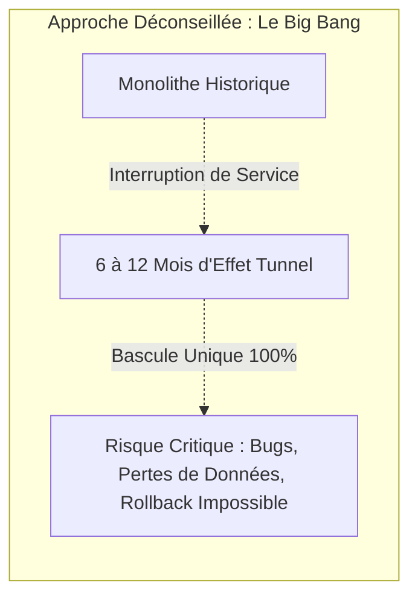
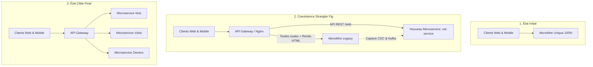
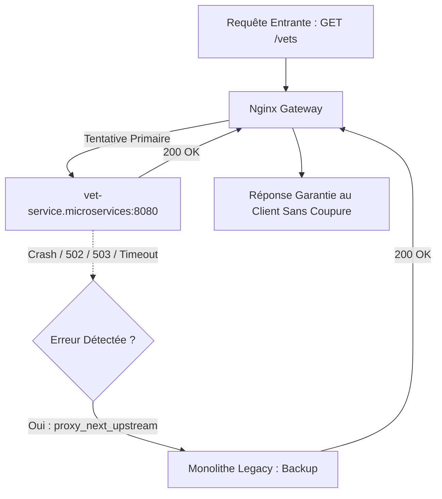
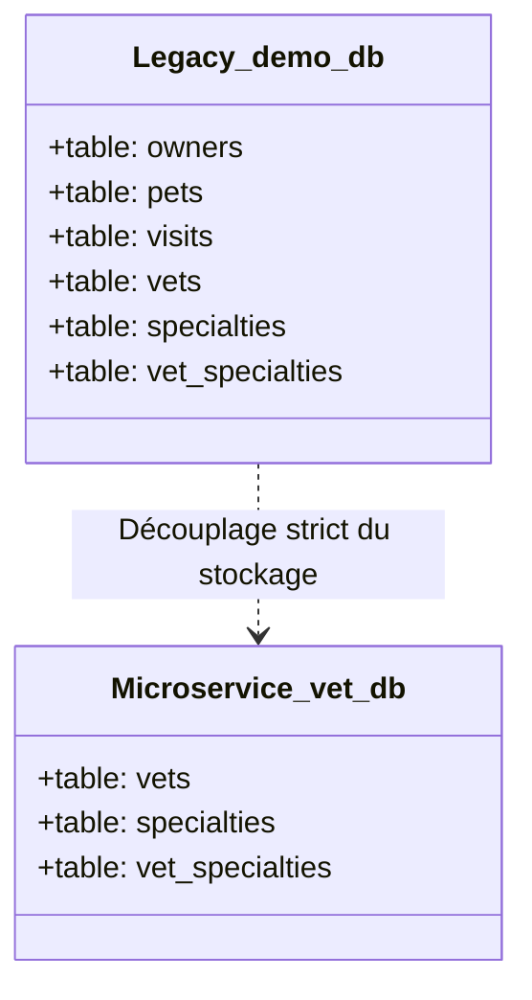
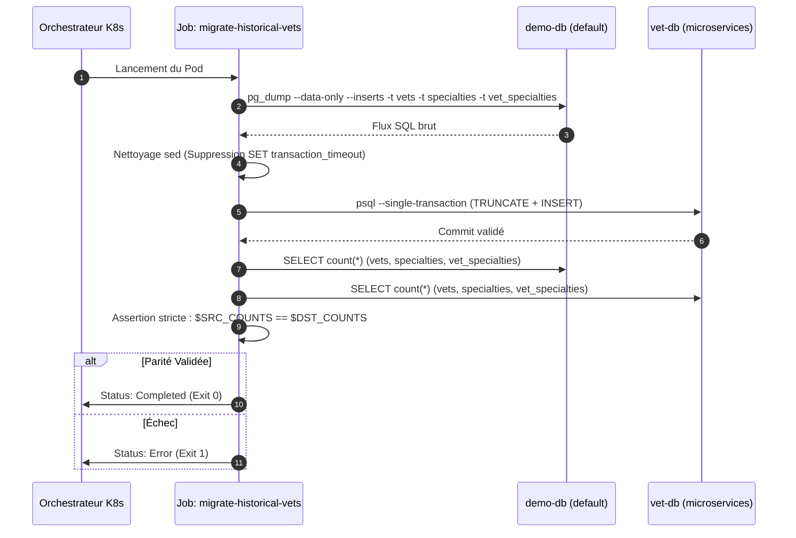
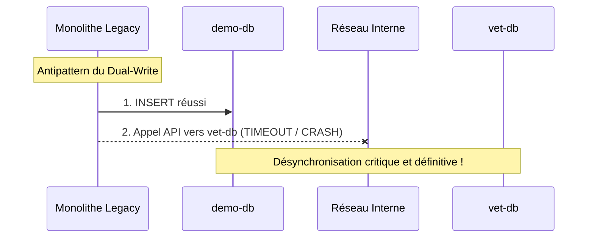
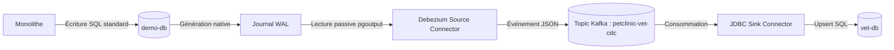

---
> **Dernière mise à jour :** Novembre 2026
>
> **Domaine :** Cloud-Native Architecture, Kubernetes, Event-Driven Systems & Data Engineering
---

# Zero-Downtime Monolith-to-Microservices Migration Factory
### Strangler Fig Pattern, CDC (Debezium / Apache Kafka) & Fallback Resilient Routing under Kubernetes

Ce projet implémente une **stratégie industrielle complète de décomposition et de migration d'un système monolithique vers une architecture microservices distribuée** sous Kubernetes, garantissant une continuité absolue d'activité (**Zero Downtime**), l'intégrité transactionnelle des données historiques et la réplication événementielle en temps réel via **Change Data Capture (CDC)**.

> [!NOTE]
> Conçu et documenté pour fournir un standard d'ingénierie réutilisable permettant de découper n'importe quel monolithe d'entreprise sans interruption de production ni risque de désynchronisation.

<div align="center">

```
==================================================================================================
        MIGRATION FACTORY : STRANGLER FIG + CHANGE DATA CAPTURE + K8S SMART GATEWAY
==================================================================================================
  [Clients / HTTP] ---> [ Nginx API Gateway ]
                              |
            +-----------------+-----------------+
            | (Route /vets)                     | (Toutes les autres routes + Fallback 502/503)
            v                                   v
    [ vet-service (Pod) ]               [ petclinic (Monolithe Legacy) ]
            |                                   |
            v                                   v
    [( vet-db PostgreSQL )]             [( demo-db PostgreSQL : WAL Logical )]
            ^                                   |
            |       +-----------------------+   |
            +-------| Kafka JDBC Sink       |<--+ (Capture continue des deltas via Debezium)
                    | & Apache Kafka Broker |
                    +-----------------------+
==================================================================================================
```

</div>

---

## Table des Matières

### [Section I : Vision d'Architecture Globale & Stratégie de Découplage](#section-1--vision-darchitecture-globale--stratégie-de-découplage)
- [Problématique Industrielle & Le Piège du "Big Bang"](#problématique-industrielle--le-piège-du-big-bang)
- [Le Strangler Fig Pattern (Figuier Étrangleur)](#le-strangler-fig-pattern-figuier-étrangleur)
- [Architecture Haute Disponibilité sous Kubernetes](#architecture-haute-disponibilité-sous-kubernetes)
- [Principes Directeurs d'Ingénierie](#principes-directeurs-dingénierie)

### [Section II : Découpage Réseau & Compartimentation Kubernetes](#section-2--découpage-réseau--compartimentation-kubernetes)
- [Topologie des Espaces de Noms (Namespaces)](#topologie-des-espaces-de-noms-namespaces)
- [L'API Gateway (Nginx) : Le Cœur de l'Aiguillage](#lapi-gateway-nginx--le-cœur-de-laiguillage)
  - [Découpage Granulaire des Chemins d'Accès](#découpage-granulaire-des-chemins-daccès)
  - [Sécurité Active & Fallback Transparent (Zero-Downtime)](#sécurité-active--fallback-transparent-zero-downtime)
  - [Traçabilité Distribuée & Métriques](#traçabilité-distribuée--métriques)

### [Section III : Architecture des Données & Pipeline de Synchronisation](#section-3--architecture-des-données--pipeline-de-synchronisation)
- [Le Modèle Database-per-Service](#le-modèle-database-per-service)
- [Phase 1 : Migration des Données Historiques (Job One-Shot)](#phase-1--migration-des-données-historiques-job-one-shot)
  - [Extraction Atomique & Résolution des Incompatibilités PG18 / PG16](#extraction-atomique--résolution-des-incompatibilités-pg18--pg16)
  - [Contrôle d'Intégrité Strict & Assertions](#contrôle-dintégrité-strict--assertions)
- [Phase 2 : Synchronisation Continue via CDC & Apache Kafka](#phase-2--synchronisation-continue-via-cdc--apache-kafka)
  - [L'Antipattern du Dual-Write & Décodage Logique du WAL](#lantipattern-du-dual-write--décodage-logique-du-wal)
  - [Cluster Kafka KRaft & Opérateur Strimzi](#cluster-kafka-kraft--opérateur-strimzi)
  - [Image Dérivée Kafka Connect & Connecteurs Déclaratifs](#image-dérivée-kafka-connect--connecteurs-déclaratifs)
  - [Connecteur Debezium Source (PostgreSQL)](#connecteur-debezium-source-postgresql)
  - [Connecteur Debezium JDBC Sink & Idempotence par Upsert](#connecteur-debezium-jdbc-sink--idempotence-par-upsert)

### [Section IV : Incidents Opérationnels Résolus & Retours d'Expérience](#section-4--incidents-opérationnels-résolus--retours-dexpérience)
- [Résolution des CrashLoopBackOff & Dimensionnement JVM](#résolution-des-crashloopbackoff--dimensionnement-jvm)
- [Découplage de Snapshot (snapshot.mode: no_data)](#découplage-de-snapshot-snapshotmode-no_data)
- [Gestion Déclarative des Secrets RBAC](#gestion-déclarative-des-secrets-rbac)

### [Section V : Guide d'Exploitation & Déploiement Reproductible](#section-5--guide-dexploitation--déploiement-reproductible)
- [Matrice des Dépendances & Prérequis](#matrice-des-dépendances--prérequis)
- [Déploiement Séquentiel Pas à Pas](#déploiement-séquentiel-pas-à-pas)
- [Validation & Cahier de Recette Postman](#validation--cahier-de-recette-postman)

---

# Section 1 : Vision d'Architecture Globale & Stratégie de Découplage

## Problématique Industrielle & Le Piège du "Big Bang"

Dans les architectures logicielles traditionnelles, le **Monolithe** centralise la totalité du code métier au sein d'un seul exécutable et s'appuie sur une unique base de données relationnelle. 



L'approche naïve consistant à réécrire l'ensemble du système en parallèle avant une bascule globale (*Big Bang*) présente des risques critiques :
1. **L'Effet Tunnel** : Gel des fonctionnalités métier pendant des mois durant le cycle de réécriture.
2. **La Rupture Transactionnelle** : Le jour de la bascule, des centaines de régressions imprévues surviennent simultanément.
3. **L'Indisponibilité Imposée** : Nécessité d'une coupure de service prolongée pour migrer les téraoctets de données.

---

## Le Strangler Fig Pattern (Figuier Étrangleur)

Inspiré du figuier étrangleur qui grandit autour d'un arbre hôte jusqu'à le remplacer progressivement, ce patron permet de démanteler le monolithe **service par service**, de manière totalement imperceptible pour l'utilisateur.



### Le Cycle de Vie d'Extraction d'un Domaine :
- **Identifier** : Extraire un domaine métier aux frontières claires (*Bounded Context* : gestion des vétérinaires).
- **Intercepter** : Déployer une API Gateway qui prend en charge l'ensemble des requêtes entrantes.
- **Réfracter les Données** : Créer une base dédiée (*Database-per-Service*) et initialiser son stock de données.
- **Synchroniser** : Écouter passivement les modifications résiduelles de l'ancien système grâce au **Change Data Capture (CDC)**.
- **Aiguiller & Sécuriser** : Rediriger la route HTTP vers le microservice avec un **fallback transparent** vers le monolithe en cas d'erreur.

---

## Architecture Haute Disponibilité sous Kubernetes

L'ensemble de l'infrastructure est déployé de façon déclarative sur Kubernetes :

```mermaid
graph TB
    Client([Clients HTTP / Navigateurs]) --> Ingress[Kubernetes Ingress Controller]

    subgraph "Namespace gateway (Point d'Entrée Unique)"
        Ingress --> GatewayService[Service: gateway :80]
        GatewayService --> GatewayPod[Pod: Nginx Reverse-Proxy :8080]
    end

    subgraph "Namespace microservices (Nouveau Monde)"
        VetService[Pod: vet-service :8080]
        VetDB[(Pod: vet-db PostgreSQL 16)]
        VetService --> VetDB
    end

    subgraph "Namespace default (Monolithe & Source)"
        MonolithPod[Pod: petclinic monolith :8080]
        DemoDB[(Pod: demo-db PostgreSQL 18 : WAL Logical)]
        MonolithPod --> DemoDB
    end

    subgraph "Namespace kafka (Data Streaming & CDC)"
        KafkaBroker[(Pod: petclinic-kafka KRaft :9092)]
        ConnectPod[Pod: debezium-connect]
        ConnectPod <--> KafkaBroker
    end

    subgraph "Orchestration Ponctuelle"
        MigrationJob[Job K8s: migrate-historical-vets]
    end

    %% Flux de Routage Réseau
    GatewayPod -->|1. Route API /vets| VetService
    GatewayPod -->|2. Route par défaut / & HTML| MonolithPod
    GatewayPod -.->|3. Fallback immédiat si 502/503| MonolithPod

    %% Flux de Données
    MigrationJob -. 1. Extraction One-Shot .-> DemoDB
    MigrationJob -. 2. Injection Atomique .-> VetDB
    ConnectPod -. Capture WAL continue .-> DemoDB
    ConnectPod -. Upsert en streaming .-> VetDB
```

---

## Principes Directeurs d'Ingénierie

1. **Zero-Downtime Absolu** : Aucune étape de migration ne nécessite l'arrêt de la production.
2. **Zéro Modification de Code Legacy** : Le monolithe continue de fonctionner sans altération de son code source grâce au CDC passif.
3. **Idempotence de Réplication** : Toute opération de données rejouée plusieurs fois produit le même résultat final sans corruption.
4. **Cloisonnement Strict** : Séparation réseau et sécuritaire par Namespaces Kubernetes et permissions RBAC.

---

# Section 2 : Découpage Réseau & Compartimentation Kubernetes

## Topologie des Espaces de Noms (Namespaces)

Pour assurer une isolation stricte des responsabilités et des privilèges réseau, le cluster est découpé en 4 espaces de noms étanches ([k8s/00-namespaces.yml](file:///c:/Users/chigu/projects/Migration/spring-petclinic/k8s/00-namespaces.yml)) :

| Namespace | Périmètre Opérationnel | Composants Déployés |
| :--- | :--- | :--- |
| **`gateway`** | Zone démilitarisée (DMZ), routage et résilience | Nginx Reverse-Proxy, ConfigMaps de routage, Ingress K8s |
| **`default`** | Environnement legacy / monolithe | Application Spring PetClinic, Base source `demo-db` (Postgres 18) |
| **`microservices`** | Nouveaux services distribués autonomes | Microservice `vet-service`, Base dédiée `vet-db` (Postgres 16), Secrets |
| **`kafka`** | Infrastructure de streaming événementiel | Cluster Kafka KRaft, Debezium Connect, KafkaConnector CRDs, Secrets Sink |

---

## L'API Gateway (Nginx) : Le Cœur de l'Aiguillage

L'API Gateway constitue le **point focal** de la migration. Elle isole les clients externes de la topologie interne du cluster.



### Découpage Granulaire des Chemins d'Accès

Dans une application web mixte (APIs REST + pages HTML générées côté serveur par Thymeleaf) :
- La route d'API de données **`GET /vets`** (format JSON) est transmise au nouveau microservice.
- La route web **`GET /vets.html`** (générée par le moteur de rendu du monolithe) doit impérativement rester sur le monolithe.

Extrait de la configuration Nginx ([k8s/gateway.yml](file:///c:/Users/chigu/projects/Migration/spring-petclinic/k8s/gateway.yml)) :

```nginx
events {}

http {
  upstream monolith_backend {
    server petclinic.default.svc.cluster.local:80 max_fails=3 fail_timeout=10s;
  }

  upstream vet_service_backend {
    server vet-service.microservices.svc.cluster.local:8080 max_fails=3 fail_timeout=10s;
    server petclinic.default.svc.cluster.local:80 backup; # <-- Cœur du Fallback
  }

  server {
    listen 8080;

    location = /healthz {
      return 200 'ok';
      add_header Content-Type text/plain;
    }

    # Route l'API REST vers le microservice tout en conservant /vets.html sur le monolithe
    location ~ ^/vets(/|$) {
      proxy_set_header Host $http_host;
      proxy_set_header X-Real-IP $remote_addr;
      proxy_set_header X-Forwarded-For $proxy_add_x_forwarded_for;
      proxy_set_header X-Request-ID $request_id;
      proxy_connect_timeout 10s;
      proxy_read_timeout 30s;

      # Sécurité Zero-Downtime : Bascule instantanée vers le monolithe en cas de défaillance
      proxy_next_upstream error timeout http_502 http_503 http_504;
      proxy_pass http://vet_service_backend;
      proxy_redirect off;
    }

    # Reste de l'application envoyé vers le monolithe
    location / {
      proxy_set_header Host $http_host;
      proxy_set_header X-Real-IP $remote_addr;
      proxy_set_header X-Forwarded-For $proxy_add_x_forwarded_for;
      proxy_set_header X-Request-ID $request_id;
      proxy_pass http://monolith_backend;
    }
  }
}
```

### Sécurité Active & Fallback Transparent (Zero-Downtime)

La directive `server petclinic.default.svc.cluster.local:80 backup;` permet d'annihiler tout risque lié à la mise en production du microservice :
- Si `vet-service` subit un incident (redémarrage, OOMKilled, saturation mémoire), Nginx intercepte le code `502 Bad Gateway` ou `503 Service Unavailable`.
- En moins de quelques millisecondes, la requête est rejouée sur le monolithe historique sans renvoyer d'erreur au client final.

### Traçabilité Distribuée & Métriques
Chaque paquet transitant par la Gateway se voit attribuer un identifiant unique via `$request_id` injecté dans l'en-tête `X-Request-ID`, garantissant la traçabilité de bout en bout des requêtes dans les logs applicatifs.

---

# Section 3 : Architecture des Données & Pipeline de Synchronisation

## Le Modèle Database-per-Service

Un microservice ne doit **jamais** partager sa base de données avec un autre composant. 



Pour le domaine extrait :
- Déploiement d'une instance PostgreSQL 16 dédiée (`vet-db`).
- Allocation d'un stockage persistant indépendant via un PersistentVolumeClaim (`vet-db-data`).
- Schéma DDL autonome instancié via `ConfigMap` déclaratif ([k8s/vet-service.yml](file:///c:/Users/chigu/projects/Migration/spring-petclinic/k8s/vet-service.yml)).

---

## Phase 1 : Migration des Données Historiques (Job One-Shot)

La base `vet-db` démarrant vide, un job Kubernetes batch one-shot (`migrate-historical-vets`) assure le transfert initial sans interruption du trafic ([k8s/migrate-historical-data-job.yml](file:///c:/Users/chigu/projects/Migration/spring-petclinic/k8s/migrate-historical-data-job.yml)).



### Extraction Atomique & Résolution des Incompatibilités PG18 / PG16
La base source (`demo-db`) tourne sous PostgreSQL 18.4, tandis que la base cible (`vet-db`) tourne sous PostgreSQL 16 Alpine. L'utilitaire `pg_dump` de PG18 génère une instruction `SET transaction_timeout = 0;` inconnue de PG16.
Le conteneur du Job résout ce problème à la volée avant injection :

```bash
# 1. Extraction granulaire des tables du domaine
pg_dump -h demo-db.default.svc.cluster.local -U user -d petclinic \
  --data-only --inserts \
  -t vets -t specialties -t vet_specialties \
  --file=/tmp/historical-vets.sql

# 2. Adaptation syntaxique multi-versions
sed '/^SET transaction_timeout = /d' /tmp/historical-vets.sql > /tmp/historical-vets-pg16.sql

# 3. Injection atomique (Rollback complet si la moindre erreur survient)
psql -X --no-psqlrc --single-transaction --set=ON_ERROR_STOP=1 \
  -h vet-db.microservices.svc.cluster.local -U vetuser -d vetdb \
  -c "TRUNCATE TABLE vet_specialties, vets, specialties RESTART IDENTITY" \
  --file=/tmp/historical-vets-pg16.sql
```

### Contrôle d'Intégrité Strict & Assertions
Pour éliminer tout risque de migration partielle, le script calcule une empreinte de volumétrie sur les deux bases et valide la stricte égalité avant de terminer :
```bash
SRC_COUNTS=$(psql -h "$SRC" -U user -d petclinic -XAt \
  -c "SELECT (SELECT count(*) FROM vets) || ':' || (SELECT count(*) FROM specialties) || ':' || (SELECT count(*) FROM vet_specialties)")

DST_COUNTS=$(psql -h "$DST" -U vetuser -d vetdb -XAt \
  -c "SELECT (SELECT count(*) FROM vets) || ':' || (SELECT count(*) FROM specialties) || ':' || (SELECT count(*) FROM vet_specialties)")

test "$SRC_COUNTS" = "$DST_COUNTS"
```

---

## Phase 2 : Synchronisation Continue via CDC & Apache Kafka

Pendant la phase de transition, des écritures continuent de survenir sur le monolithe. Les modifications doivent être répliquées en continu vers la nouvelle base sans double écriture applicative.

### L'Antipattern du Dual-Write & Décodage Logique du WAL



Le **Dual-Write** (demander au monolithe d'écrire en base locale ET d'envoyer un appel réseau au microservice) est proscrit. En cas de crash ou timeout réseau, les bases divergent irrémédiablement.

**La Solution : Change Data Capture (CDC)**  
PostgreSQL consigne toute transaction validée dans son journal physique **WAL** (*Write-Ahead Log*). En configurant PostgreSQL avec `wal_level=logical`, le moteur expose un flux de réplication logique via l'extension native `pgoutput`. L'application legacy n'a aucune ligne de code modifiée.



### Cluster Kafka KRaft & Opérateur Strimzi

L'infrastructure d'événements est orchestrée de façon déclarative par l'opérateur **Strimzi** sous Kubernetes ([k8s/kafka.yml](file:///c:/Users/chigu/projects/Migration/spring-petclinic/k8s/kafka.yml)) :
- **Mode KRaft** : Suppression totale de ZooKeeper pour une empreinte mémoire réduite et une résilience accrue.
- **NodePool Déclaratif** : Déploiement d'un broker optimisé avec listener plain sur le port 9092.

### Image Dérivée Kafka Connect & Connecteurs Déclaratifs

L'image officielle Strimzi n'embarque pas les connecteurs tiers. Une image dérivée a été compilée ([k8s/debezium-connect.Dockerfile](file:///c:/Users/chigu/projects/Migration/spring-petclinic/k8s/debezium-connect.Dockerfile)) :
```dockerfile
FROM quay.io/strimzi/kafka:1.3.0-kafka-4.3.1
USER root:root
RUN mkdir -p /opt/kafka/plugins/debezium-postgres \
    && curl -fL --output /tmp/debezium-postgres.tgz https://repo1.maven.org/maven2/io/debezium/debezium-connector-postgres/3.7.0.Final/debezium-connector-postgres-3.7.0.Final-plugin.tar.gz \
    && tar -xzf /tmp/debezium-postgres.tgz -C /opt/kafka/plugins/debezium-postgres \
    && mkdir -p /opt/kafka/plugins/debezium-jdbc \
    && curl -fL --output /tmp/debezium-jdbc.tgz https://repo.maven.apache.org/maven2/io/debezium/debezium-connector-jdbc/3.7.0.Final/debezium-connector-jdbc-3.7.0.Final-plugin.tar.gz \
    && tar -xzf /tmp/debezium-jdbc.tgz -C /opt/kafka/plugins/debezium-jdbc \
    && curl -fL --output /opt/kafka/plugins/debezium-jdbc/postgresql-42.7.7.jar https://repo.maven.apache.org/maven2/org/postgresql/postgresql/42.7.7/postgresql-42.7.7.jar \
    && rm -f /tmp/debezium-postgres.tgz /tmp/debezium-jdbc.tgz
USER 1001
```

### Connecteur Debezium Source (PostgreSQL)

Le connecteur source capture en temps réel les deltas sur les tables cibles :
```yaml
apiVersion: kafka.strimzi.io/v1
kind: KafkaConnector
metadata:
  name: petclinic-postgres-source
  namespace: kafka
spec:
  class: io.debezium.connector.postgresql.PostgresConnector
  tasksMax: 1
  config:
    database.hostname: demo-db.default.svc.cluster.local
    database.port: 5432
    database.dbname: petclinic
    topic.prefix: petclinic-vet-cdc
    table.include.list: "public.vets,public.specialties,public.vet_specialties"
    plugin.name: pgoutput
    slot.name: debezium_petclinic
    publication.name: debezium_pub
    publication.autocreate.mode: filtered
    snapshot.mode: no_data # Évite la surcharge du snapshot initial déjà traité par le Job
```

### Connecteur Debezium JDBC Sink & Idempotence par Upsert

Le connecteur Sink lit le topic Kafka et applique les modifications dans `vet-db` :
```yaml
apiVersion: kafka.strimzi.io/v1
kind: KafkaConnector
metadata:
  name: vet-vets-sink
  namespace: kafka
spec:
  class: io.debezium.connector.jdbc.JdbcSinkConnector
  tasksMax: 1
  config:
    topics: petclinic-vet-cdc.public.vets
    connection.url: jdbc:postgresql://vet-db.microservices.svc.cluster.local:5432/vetdb
    connection.username: ${secrets:kafka/vet-db-sink:username}
    connection.password: ${secrets:kafka/vet-db-sink:password}
    insert.mode: upsert
    primary.key.mode: record_key
    primary.key.fields: id
    table.name.format: vets
```
> **Garantie d'Idempotence** : Grâce à `insert.mode: upsert`, si un événement est rejoué suite à une reprise sur incident, la ligne est mise à jour plutôt que de déclencher une violation de clé unique.

---

# Section 4 : Incidents Opérationnels Résolus & Retours d'Expérience

Durant la mise en œuvre de cette plateforme sur un nœud Kubernetes contraint, plusieurs défis techniques réels ont été surmontés :

### 1. Résolution des CrashLoopBackOff & Dimensionnement JVM
* **Problème** : Les pods Kafka, Topic Operator et Debezium Connect redémarraient fréquemment (`Exit Code 137 - OOMKilled`).
* **Analyse** : Les runtimes Java sous conteneur tendent à réserver une mémoire virtuelle excessive si les flags JVM ne sont pas explicitement bridés.
* **Résolution** :
  - Bridage direct du tas JVM dans les manifestes Strimzi :
    - Kafka Broker : `-Xms: 256m`, `-Xmx: 384m`
    - Kafka Connect : `-Xms: 256m`, `-Xmx: 512m`
  - Augmentation des seuils de liveness/readiness probes (`initialDelaySeconds: 180`) pour tolérer le démarrage sur disque lent.

### 2. Découplage de Snapshot (`snapshot.mode: no_data`)
* **Problème** : Au démarrage, Debezium effectue par défaut un snapshot complet en verrouillant les tables pour garantir la consistance, provoquant des timeouts sur l'application.
* **Résolution** : Séparation stricte des responsabilités. Le chargement initial est dévolu au **Job Kubernetes batch**, et Debezium démarre directement en mode streaming passif via `snapshot.mode: no_data`.

### 3. Gestion Déclarative des Secrets RBAC
* **Problème** : Kafka Connect doit s'authentifier auprès de `vet-db` sans exposer les mots de passe en clair dans les CRDs.
* **Résolution** : Mise en place d'un `Role` et `RoleBinding` Kubernetes autorisant le compte de service `debezium-connect-connect` à lire le secret `vet-db-sink`, consommé via l'interpoleur `${secrets:kafka/vet-db-sink:password}`.

---

# Section 5 : Guide d'Exploitation & Déploiement Reproductible

## Matrice des Dépendances & Prérequis
- Kubernetes v1.28+ (Minikube ou cluster Cloud managé)
- `kubectl` configuré
- Minimum 4 CPU / 8 Go de RAM alloués à la VM Kubernetes

---

## Déploiement Séquentiel Pas à Pas

### Étape 1 : Initialisation des Espaces de Noms
```bash
kubectl apply -f k8s/00-namespaces.yml
```

### Étape 2 : Déploiement du Socle Monolithe & BDD Source
```bash
kubectl apply -f k8s/db.yml
kubectl apply -f k8s/petclinic.yml
kubectl wait --for=condition=ready pod -l app=demo-db -n default --timeout=120s
```

### Étape 3 : Déploiement du Microservice & BDD Dédiée
```bash
kubectl apply -f k8s/vet-service.yml
kubectl wait --for=condition=ready pod -l app=vet-db -n microservices --timeout=120s
```

### Étape 4 : Exécution du Job de Migration Historique
```bash
kubectl apply -f k8s/migrate-historical-data-job.yml
kubectl wait --for=condition=complete job/migrate-historical-vets -n default --timeout=180s
```

### Étape 5 : Déploiement du Pipeline CDC & Kafka
```bash
# Construction locale de l'image Debezium (si Minikube)
minikube image build -t debezium-connect:3.7.0-cdc1 -f k8s/debezium-connect.Dockerfile .

# Déploiement de Strimzi et des connecteurs
kubectl apply -f k8s/kafka.yml
```

### Étape 6 : Activation de l'API Gateway Nginx
```bash
kubectl apply -f k8s/gateway.yml
kubectl wait --for=condition=ready pod -l app=gateway -n gateway --timeout=90s
```

---

## Validation & Cahier de Recette Postman

Pour valider l'architecture de bout en bout, ouvrez un port-forward local vers la Gateway :

```powershell
kubectl port-forward -n gateway svc/gateway 8080:80
```

### 1. Test de Santé de la Gateway
* **Requête** : `GET http://localhost:8080/healthz`
* **Résultat Attendu** : `200 OK` (`ok`).

### 2. Validation du Routage Microservice (Données Migrées)
* **Requête** : `GET http://localhost:8080/vets` (Header: `Accept: application/json`)
* **Résultat Attendu** : `200 OK` avec le tableau JSON issu de `vet-db`.

### 3. Validation de Non-Régression sur le Monolithe
* **Requête** : `GET http://localhost:8080/owners`
* **Résultat Attendu** : `200 OK` servie par le monolithe legacy.
* **Requête Web** : `GET http://localhost:8080/vets.html`
* **Résultat Attendu** : Page HTML Thymeleaf servie par le monolithe.

### 4. Crash-Test de Résilience Zéro-Downtime
1. Simulez l'arrêt brutal du microservice :
   ```bash
   kubectl scale deployment vet-service -n microservices --replicas=0
   ```
2. Rejouez immédiatement `GET http://localhost:8080/vets` :
   - **Résultat** : Toujours `200 OK` ! Nginx a détecté la coupure et a redirigé le trafic vers le monolithe en `backup` de façon transparente.
3. Rétablissez le microservice :
   ```bash
   kubectl scale deployment vet-service -n microservices --replicas=1
   ```

---

<div align="center">

**Cette usine de migration fournit une architecture prête pour la production, éprouvée contre les pannes et prête à accueillir le découpage des domaines suivants (`visits`, `owners`, `pets`).**

</div>
