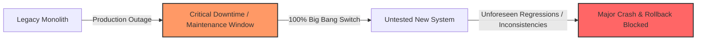
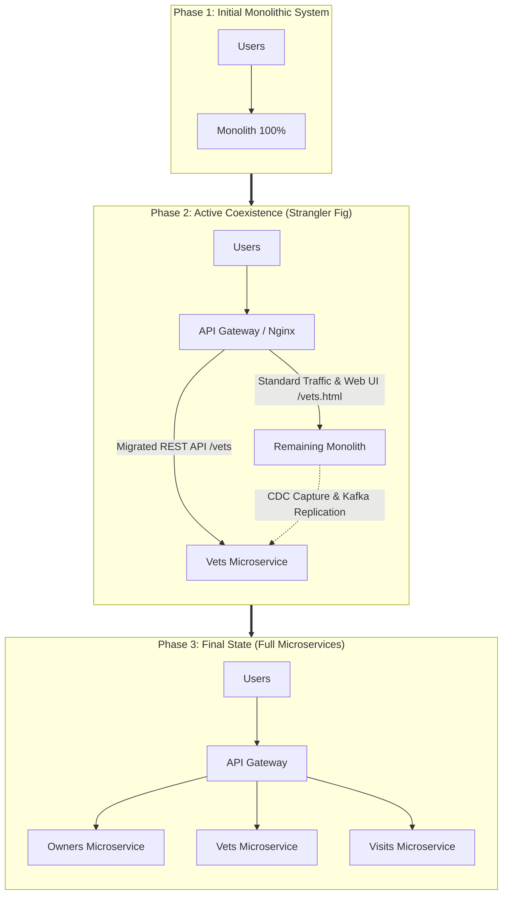
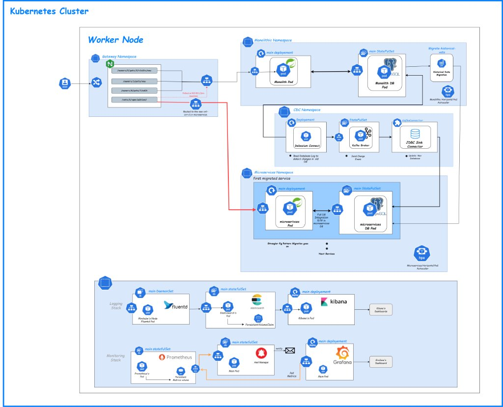
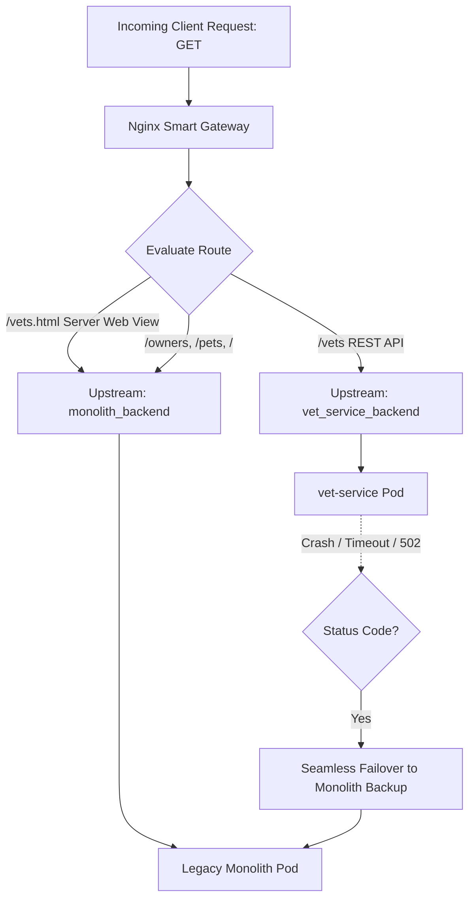
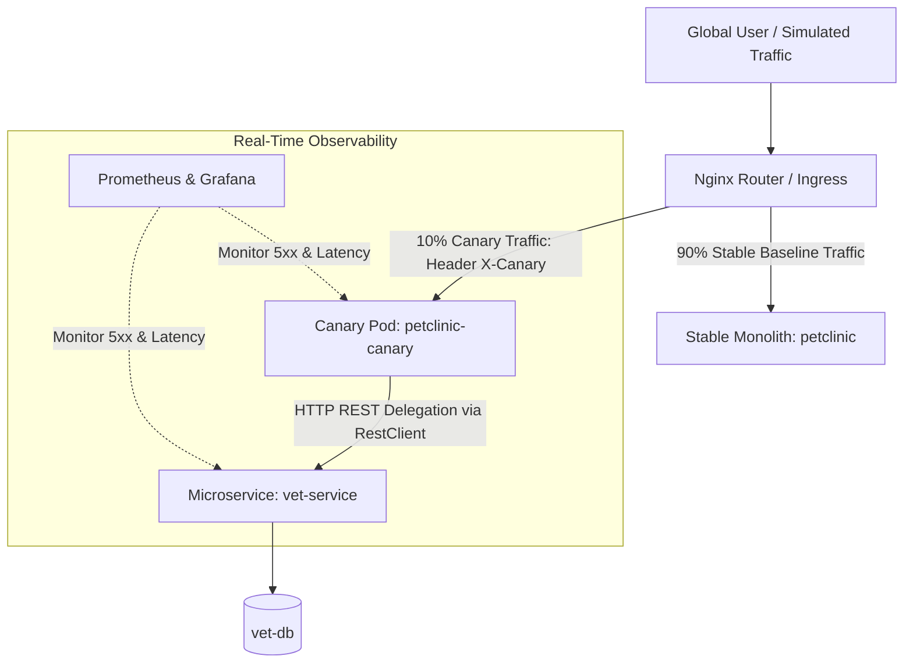
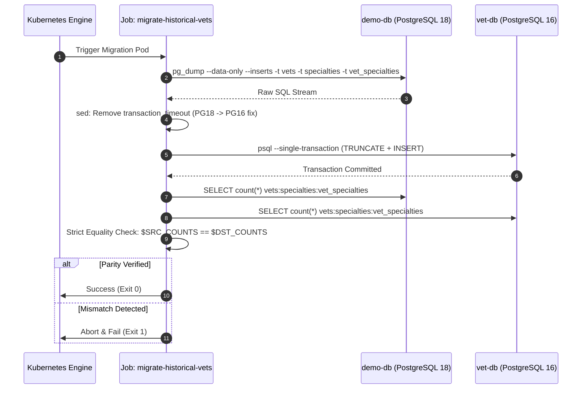
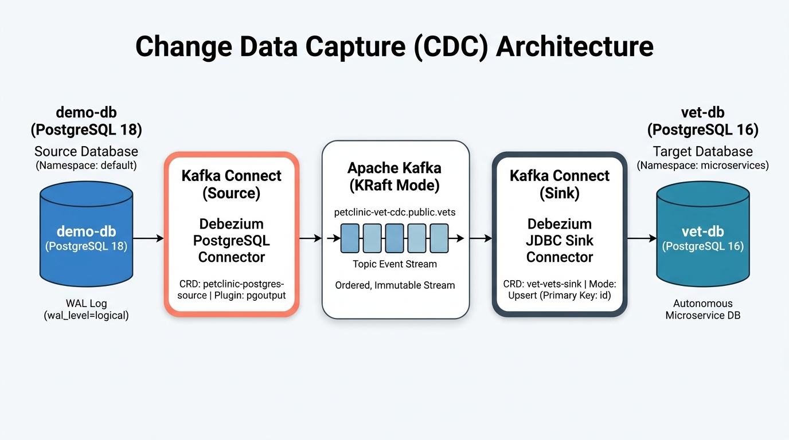
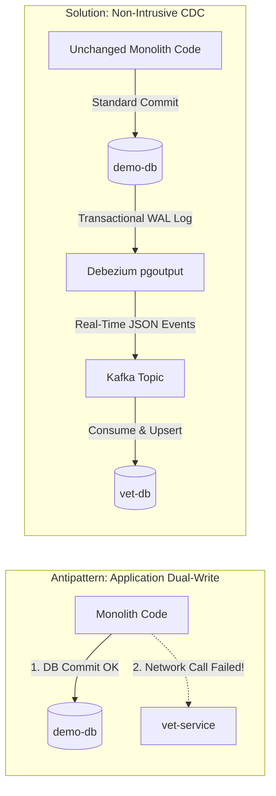
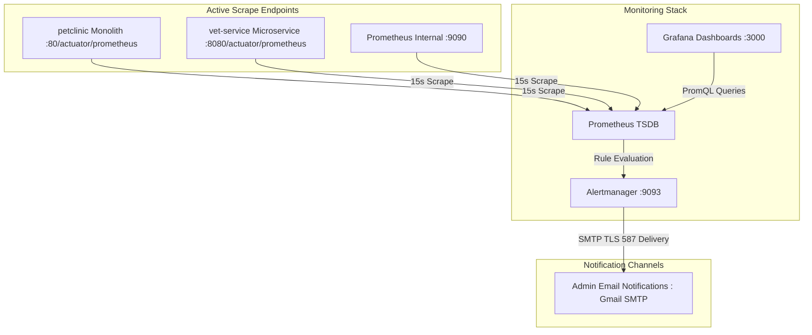

> **Project Author:** Abderrahmane Chiguer ([GitHub](https://github.com/abdochiguer))  
> **Technical Stack:** Kubernetes, Spring Boot, Nginx, PostgreSQL, Debezium CDC, Apache Kafka (KRaft), Prometheus, Alertmanager, Grafana, Fluentd, Elasticsearch, Kibana  
> **Objective:** Zero-Downtime migration of a monolithic system to microservices using the Strangler Fig Pattern, CDC, and end-to-end observability.

---

# StranglerFlow: Zero-Downtime Monolith-to-Microservices Migration Environment
### Event-Driven Decomposition via Strangler Fig, Debezium CDC, Kafka KRaft & Full Observability on Kubernetes

This project provides a **complete, production-grade implementation** for decomposing a monolithic enterprise application into a distributed microservices architecture on **Kubernetes**, ensuring:
1. **Total Business Continuity (Zero-Downtime)** with no service interruption for end users.
2. **Data Integrity and Consistency** via strict *Database-per-Service* decoupling, an atomic batch historical migration job, and continuous real-time synchronization through **Change Data Capture (CDC)** powered by Debezium and Apache Kafka.
3. **Active Network Resilience** orchestrated by an intelligent Nginx API Gateway with automatic failover (*Fallback*) to the monolith if the new microservice encounters an issue.
4. **Enterprise Observability** featuring application and system metrics, automated email alerting, and centralized real-time log aggregation (Prometheus, Alertmanager, Grafana, Fluentd, Elasticsearch, Kibana).

---

## Table of Contents

### [Section I: Strategic Vision & Strangler Fig Pattern](#section-i-strategic-vision--strangler-fig-pattern)
- [Why the "Big Bang" approach is a critical pitfall](#why-the-big-bang-approach-is-a-critical-pitfall)
- [The Strangler Fig Pattern explained chronologically](#the-strangler-fig-pattern-explained-chronologically)
- [Target Architecture & System Overview](#target-architecture--system-overview)

### [Section II: Network Segmentation, Smart Routing & Resilience](#section-ii-network-segmentation-smart-routing--resilience)
- [Kubernetes Namespace Topology](#kubernetes-namespace-topology)
- [The Nginx API Gateway: Smart Routing](#the-nginx-api-gateway-smart-routing)
- [Transparent Failover Mechanism (Zero-Downtime Fallback)](#transparent-failover-mechanism-zero-downtime-fallback)
- [Canary Deployment: Progressive Traffic Shifting](#canary-deployment-progressive-traffic-shifting)

### [Section III: Data Decoupling & Synchronization Pipeline](#section-iii-data-decoupling--synchronization-pipeline)
- [The Database-per-Service Model](#the-database-per-service-model)
- [Phase 1: Historical Data Migration (Kubernetes Batch Job)](#phase-1-historical-data-migration-kubernetes-batch-job)
- [Phase 2: Continuous Real-Time CDC Synchronization (Debezium & Kafka KRaft)](#phase-2-continuous-real-time-cdc-synchronization-debezium--kafka-kraft)
  - [The Dual-Write Antipattern & PostgreSQL WAL](#the-dual-write-antipattern--postgresql-wal)
  - [Kafka KRaft Cluster & Declarative Connectors](#kafka-kraft-cluster--declarative-connectors)
  - [Idempotency & Conflict Resolution via JDBC Upsert](#idempotency--conflict-resolution-via-jdbc-upsert)

### [Section IV: Full Observability Stack: Metrics, Alerts & Centralized Logging](#section-iv-full-observability-stack-metrics-alerts--centralized-logging)
- [Monitoring Stack Architecture (Prometheus, Alertmanager & Grafana)](#monitoring-stack-architecture-prometheus-alertmanager--grafana)
- [Active Alerting Rules & Automated Notifications](#active-alerting-rules--automated-notifications)
- [Logging Stack Architecture (EFK: Fluentd, Elasticsearch & Kibana)](#logging-stack-architecture-efk-fluentd-elasticsearch--kibana)

### [Section V: Production Incidents & Engineering Solutions](#section-v-production-incidents--engineering-solutions)
- [CrashLoopBackOff & JVM Memory Tuning for Kafka Brokers](#crashloopbackoff--jvm-memory-tuning-for-kafka-brokers)
- [Cross-Version PostgreSQL Incompatibilities (PG18 vs PG16)](#cross-version-postgresql-incompatibilities-pg18-vs-pg16)
- [Snapshot Decoupling (snapshot.mode: no_data)](#snapshot-decoupling-snapshotmode-no_data)

### [Section VI: Operations Guide & Testing Workbook](#section-vi-operations-guide--testing-workbook)
- [Reproducible Step-by-Step Deployment](#reproducible-step-by-step-deployment)
- [Validation & Postman Test Suite](#validation--postman-test-suite)
- [Local Traffic Simulator (Canary & Load Testing)](#local-traffic-simulator-canary--load-testing)

---

# Section I: Strategic Vision & Strangler Fig Pattern

## Why the "Big Bang" approach is a critical pitfall

In software engineering, the naive **Big Bang** strategy attempts to rewrite an entire application from scratch over several months, then cut over 100% of production traffic over a weekend.



This approach almost always fails in enterprise environments due to three main factors:
1. **The Tunnel Effect:** Business features are frozen for months; no new value reaches users during the rewrite.
2. **Transactional Cliff:** Migrating entire relational databases in one shot causes prolonged downtime and severe risks of data corruption.
3. **Impossible Rollback:** If latent bugs emerge under peak production load, reverting back to the legacy state without data loss is extremely difficult.

---

## The Strangler Fig Pattern explained chronologically

To eliminate these hazards, this project implements the **Strangler Fig Pattern**. Inspired by the tropical vine that grows around a host tree and gradually replaces it without leaving an empty void, this pattern replaces the monolith **service by service**, completely unnoticed by end users.



### Applied Engineering Methodology:
1. **Identify the Pilot Bounded Context:** The **Veterinarians (`vets`)** domain was extracted first because its relational boundaries are well isolated, proving the entire infrastructure pipeline without risking core transactional modules.
2. **Deploy an Interception Gateway:** All incoming traffic hits an Nginx API Gateway that makes routing decisions.
3. **Decouple the Database:** Deploy a dedicated database (`vet-db`), seeded with historical records.
4. **Continuous Non-Intrusive Replication:** Capture data deltas through CDC and Kafka to guarantee data freshness without touching legacy application code.
5. **Route and Secure with Fallback:** Route live HTTP traffic to the microservice while maintaining a transparent fallback to the monolith.

---

## Target Architecture & System Overview

The complete production architecture deployed on the Kubernetes cluster is represented below, orchestrating the Ingress Gateway, the legacy monolith, the extracted microservice, the CDC streaming engine, and the end-to-end monitoring/logging stacks:

<div align="center">



*Figure: Complete Production Kubernetes Architecture on Worker Node — Ingress Routing, Strangler Fig, CDC Kafka Pipeline & Observability Stack*

</div>

### Architectural Highlights & Key Notes (from the Diagram)

#### 1. Ingress & Smart Gateway (`gateway` Namespace)
* **Path-Based Traffic Splitting:**
  * Requests matching `/vets/*` (such as `/vets/1/specialties?format=json`) are routed directly to the new `vet-service` microservice.
  * All other domain routes (`/owners/*`, `/pets/*`, `/visits/*`) and the legacy server-rendered template `/vets.html` remain routed to the `petclinic` monolith.
* **Active Zero-Downtime Fallback (502 / 503 Resiliency):**
  * Configured via Nginx `proxy_next_upstream error timeout http_502 http_503 http_504;` and `server petclinic.default.svc.cluster.local:80 backup;`.
  * If the `vet-service` pod crashes, encounters an Out-Of-Memory failure (`OOMKilled`), or enters a rolling restart, Nginx immediately and transparently replays the request against the monolith. **End users never see an HTTP 502 or 503 outage.**

#### 2. Legacy Monolith & Initial Historical Migration (`default` Namespace)
* **Monolith Workload:** The Spring PetClinic application runs alongside its PostgreSQL database (`demo-db`).
* **Step 1: Batch Historical Seeding (`Migrate-historical-vets` Job):**
  * An automated, one-shot Kubernetes Job extracts records from domain tables (`vets`, `specialties`, `vet_specialties`).
  * Injects the dataset into `vet-db` inside an atomic transaction (`--single-transaction`).
  * Strips PostgreSQL 18-specific syntax (`SET transaction_timeout = 0;`) using an inline `sed` filter for compatibility with PostgreSQL 16.
  * Enforces a strict blocking row-count verification assertion (`test $SRC_COUNTS == $DST_COUNTS`).

#### 3. Real-Time Data Streaming & CDC (`kafka` Namespace)
* **Step 2: Continuous Real-Time CDC Replication:**
  * **Dual-Write Prevention:** The monolith code remains completely untouched. PostgreSQL writes committed transactions to its internal Write-Ahead Log (**WAL**).
  * **Debezium Source Connector:** Tail-reads the WAL using the native `pgoutput` logical replication plugin and publishes change events as JSON messages into Kafka.
  * **Kafka Broker (KRaft Mode):** Operates on a single lightweight node without ZooKeeper dependency, minimizing memory footprints.
  * **Debezium JDBC Sink Connector:** Consumes the `petclinic-vet-cdc.public.vets` topic and performs an **Idempotent Upsert** (`INSERT` or `UPDATE`) on primary key `id` directly into `vet-db`.

#### 4. Modern Decoupled Domain (`microservices` Namespace)
* **Database-per-Service Isolation:** `vet-service` connects exclusively to its dedicated PostgreSQL 16 database (`vet-db`), backed by an isolated 2Gi PersistentVolumeClaim (`vet-db-data`).
* **Canary Progression:** Designed to support gradual traffic shifting (10% $\rightarrow$ 50% $\rightarrow$ 100%) prior to final monolith decommissioning.

#### 5. Unified Enterprise Observability (`monitoring` & `logging` Namespaces)
* **Logging Stack (EFK):**
  * **Fluentd (DaemonSet):** Deployed on each cluster worker node, tailing `/var/log/containers/*.log`, enriching records with Kubernetes pod metadata.
  * **Elasticsearch (StatefulSet/Pod):** Ingests and indexes logs with persistent volume storage and bounded JVM heaps.
  * **Kibana (Deployment):** Web analytics interface to search, filter, and trace errors across all microservices and monolith components.
* **Monitoring Stack:**
  * **Prometheus (StatefulSet/Pod):** Scrapes Spring Boot Actuator endpoints (`/actuator/prometheus`) every 15s.
  * **Alertmanager (StatefulSet/Pod):** Evaluates alert rules (`ServiceDown`, `HighHttp5xxRate`, `PodFrequentRestarts`) and dispatches TLS-encrypted alerts to administrator mailboxes.
  * **Grafana (Deployment):** Pre-provisioned dashboards for live visual monitoring of latency, throughput, and memory consumption.

---

# Section II: Network Segmentation, Smart Routing & Resilience

## Kubernetes Namespace Topology

To prevent tight coupling and enforce defense-in-depth, the cluster is partitioned into 5 isolated namespaces ([k8s/00-namespaces.yml](file:///c:/Users/chigu/projects/Migration/spring-petclinic/k8s/00-namespaces.yml)):

| Namespace | Operational Role | Key Components |
| :--- | :--- | :--- |
| **`gateway`** | Ingress perimeter, traffic filtering, and resilience | Nginx Ingress, Nginx Reverse-Proxy Pod, Routing ConfigMaps |
| **`default`** | Legacy monolith hosting environment | Spring PetClinic Monolith, Source DB `demo-db` (Postgres 18) |
| **`microservices`** | Autonomous decoupled services | `vet-service` (REST API), Dedicated DB `vet-db` (Postgres 16) |
| **`kafka`** | Event ingestion and data replication pipeline | Kafka Cluster (KRaft), Debezium Connect, CDC Connectors |
| **`monitoring`** | Metric collection and alerting stack | Prometheus, Alertmanager, Grafana, SMTP Gmail Notifications |
| **`logging`** | Centralized log ingestion and search | Fluentd DaemonSet, Elasticsearch 8.10, Kibana |

---

## The Nginx API Gateway: Smart Routing

The API Gateway acts as the central traffic switch, separating API calls from legacy server-rendered views:



### Applied Nginx Routing Configuration ([k8s/gateway.yml](file:///c:/Users/chigu/projects/Migration/spring-petclinic/k8s/gateway.yml)):
```nginx
upstream vet_service_backend {
    server vet-service.microservices.svc.cluster.local:8080 max_fails=3 fail_timeout=10s;
    server petclinic.default.svc.cluster.local:80 backup; # <-- Standby Monolith for immediate fallback
}

upstream monolith_backend {
    server petclinic.default.svc.cluster.local:80 max_fails=3 fail_timeout=10s;
}

server {
    listen 8080;

    location = /healthz {
        return 200 'ok';
        add_header Content-Type text/plain;
    }

    # Route JSON REST API to the new microservice
    location ~ ^/vets(/|$) {
        proxy_set_header Host $http_host;
        proxy_set_header X-Real-IP $remote_addr;
        proxy_set_header X-Forwarded-For $proxy_add_x_forwarded_for;
        proxy_set_header X-Request-ID $request_id;
        proxy_connect_timeout 10s;
        proxy_read_timeout 30s;

        # Zero-Downtime Resilience: On error, immediately replay on backup
        proxy_next_upstream error timeout http_502 http_503 http_504;
        proxy_pass http://vet_service_backend;
        proxy_redirect off;
    }

    # All other traffic (including /vets.html and /owners) remains on the monolith
    location / {
        proxy_set_header Host $http_host;
        proxy_set_header X-Real-IP $remote_addr;
        proxy_set_header X-Forwarded-For $proxy_add_x_forwarded_for;
        proxy_set_header X-Request-ID $request_id;
        proxy_pass http://monolith_backend;
    }
}
```

---

## Transparent Failover Mechanism (Zero-Downtime Fallback)

The combination of `server petclinic.default.svc.cluster.local:80 backup;` and `proxy_next_upstream error timeout http_502 http_503 http_504;` eliminates deployment release risks:
1. A client initiates `GET /vets`.
2. Nginx dispatches the call to `vet-service`.
3. If the microservice pod restarts, crashes, or encounters an Out-Of-Memory failure (502/503):
   - Nginx intercepts the error internally.
   - The exact request is immediately re-executed against the monolith defined as `backup`.
   - **The end client receives a successful HTTP 200 response without noticing any disruption.**

---

## Canary Deployment: Progressive Traffic Shifting

Even when the microservice is operational and continuously synced via CDC, shifting 100% of production traffic instantly presents unnecessary risk. This architecture introduces a **Canary Deployment** pattern to validate the new stack under controlled traffic increments.



### 1. Canary Pod Architecture ([k8s/petclinic-canary.yml](file:///c:/Users/chigu/projects/Migration/spring-petclinic/k8s/petclinic-canary.yml))
A dedicated `petclinic-canary` deployment runs concurrently with the monolith:
- Runs container image `petclinic:canary-cdc2`.
- Enables outbound delegation to the microservice via Spring Boot properties:
  ```json
  "petclinic.services.vet.base-url": "http://vet-service.microservices.svc.cluster.local:8080",
  "petclinic.services.vet.connect-timeout": "2s",
  "petclinic.services.vet.read-timeout": "15s"
  ```
- Uses a `RollingUpdate` deployment strategy with `maxUnavailable: 0` for zero-downtime rolling upgrades.

### 2. Intelligent Delegation & Application Circuit Breaker
At the application tier ([VetServiceClient.java](file:///c:/Users/chigu/projects/Migration/spring-petclinic/src/main/java/org/springframework/samples/petclinic/vet/VetServiceClient.java) and [VetController.java](file:///c:/Users/chigu/projects/Migration/spring-petclinic/src/main/java/org/springframework/samples/petclinic/vet/VetController.java)):
- When the REST client to `vet-service` is enabled (Canary Pod), the controller delegates queries to the microservice.
- **Application Resilience:** If the microservice times out or fails (`RestClientException`), the controller catches the exception and falls back to the local `VetRepository` (monolith DB), preventing user-facing HTTP 500 errors.

### 3. Traffic Progression Strategy
1. **Step 1 (Smoke Testing - 0%):** Canary pod deployed; targeted with internal test headers (`X-Canary: true`).
2. **Step 2 (Initial Sample - 10%):** Route a 10% slice (`canary-weight: 10`). Monitor Grafana dashboards and the `HighHttp5xxRate` alert rule.
3. **Step 3 (Load Expansion - 50%):** Confirm sustained latency and reliability under significant production volume.
4. **Step 4 (Full Cutover - 100%):** Route the Nginx `/vets` endpoint directly to `vet-service` at 100%, and safely decommission the canary pod.

---

# Section III: Data Decoupling & Synchronization Pipeline

## The Database-per-Service Model

Sharing databases across services introduces hidden schema coupling and cross-domain locking. To prevent this, the extracted service operates its own PostgreSQL 16 Alpine database (`vet-db`), backed by an isolated PersistentVolumeClaim (`vet-db-data`) and declarative ConfigMap schema initialization ([k8s/vet-service.yml](file:///c:/Users/chigu/projects/Migration/spring-petclinic/k8s/vet-service.yml)).

---

## Phase 1: Historical Data Migration (Kubernetes Batch Job)

To populate `vet-db` with historical records from the legacy database without manual scripts, an automated Kubernetes Job was designed ([k8s/migrate-historical-data-job.yml](file:///c:/Users/chigu/projects/Migration/spring-petclinic/k8s/migrate-historical-data-job.yml)).



### Engineering Details of the Migration Job:
- **Granular Dump:** Uses `pg_dump` targeting only domain-relevant tables (`vets`, `specialties`, `vet_specialties`).
- **Cross-Version Adaptation:** Strips PostgreSQL 18-specific instructions (`SET transaction_timeout = 0;`) using `sed` to maintain compatibility with PostgreSQL 16.
- **Transactional Atomicity:** Executes under `--single-transaction --set=ON_ERROR_STOP=1`. If any record fails, the entire batch rolls back cleanly.
- **Automated Validation:** Compares row counts between source and destination before marking the Job as complete (`test "$SRC_COUNTS" = "$DST_COUNTS"`).

---

## Phase 2: Continuous Real-Time CDC Synchronization (Debezium & Kafka KRaft)

<div align="center">



*Figure: End-to-End Real-Time CDC Streaming Pipeline — PostgreSQL Logical Decoding (WAL), Debezium Source, Kafka KRaft Topic & JDBC Sink Upsert*

</div>

### The Dual-Write Antipattern & PostgreSQL WAL



Attempting to write to two databases simultaneously from application code (**Dual-Write**) causes silent data divergences during network timeouts or partial failures.

**The Solution: Change Data Capture (CDC)**  
The source database is configured with `wal_level=logical`. Every committed transaction is logged to PostgreSQL's **Write-Ahead Log (WAL)**. **Debezium** tail-reads this log passively using the `pgoutput` plugin without adding application overhead and without touching any monolith code.

### Kafka KRaft Cluster & Declarative Connectors

The event backbone runs on **Strimzi** in **KRaft mode** (without ZooKeeper), drastically lowering memory footprint and eliminating ZooKeeper synchronization lag ([k8s/kafka.yml](file:///c:/Users/chigu/projects/Migration/spring-petclinic/k8s/kafka.yml)).

A custom Kafka Connect image was assembled ([k8s/debezium-connect.Dockerfile](file:///c:/Users/chigu/projects/Migration/spring-petclinic/k8s/debezium-connect.Dockerfile)) containing both **Debezium PostgreSQL** and **Debezium JDBC Sink** plugins.

### Idempotency & Conflict Resolution via JDBC Upsert

The consumer connector `vet-vets-sink` reads messages from topic `petclinic-vet-cdc.public.vets` and applies changes to `vet-db` configured with:
- `insert.mode: upsert`
- `primary.key.mode: record_key`
- `primary.key.fields: id`

> **Why Upsert is Critical:**  
> If an event is re-delivered during a pod crash recovery or network retry, the record is updated in place instead of triggering a duplicate key violation. The pipeline is **100% idempotent**.

---

# Section IV: Full Observability Stack: Metrics, Alerts & Centralized Logging

A production migration without deep observability is running blind. This architecture integrates a full metrics and log collection stack.

## Monitoring Stack Architecture (Prometheus, Alertmanager & Grafana)

The `monitoring` namespace consolidates system and application metrics ([k8s/monitoring-stack.yml](file:///c:/Users/chigu/projects/Migration/spring-petclinic/k8s/monitoring-stack.yml)):



- **Prometheus (v2.55.1):** Scrapes Spring Boot Actuator endpoints (`/actuator/prometheus`) every 15 seconds across both monolith and microservice tiers, stored on a 2Gi PVC.
- **Grafana (v11.4.0):** Dashboards auto-provisioned via ConfigMaps connecting directly to Prometheus.
- **Alertmanager (v0.27.0):** Alert grouping (`group_wait: 10s`), deduplication, and encrypted email forwarding.

---

## Active Alerting Rules & Automated Notifications

Three operational alert rules are actively enforced ([k8s/monitoring-stack.yml](file:///c:/Users/chigu/projects/Migration/spring-petclinic/k8s/monitoring-stack.yml)):

1. **`ServiceDown` (Severity: Critical):**
   - Trigger: `up == 0` for more than 1 minute.
   - Purpose: Detects when `vet-service` or `petclinic` stops responding.
2. **`HighHttp5xxRate` (Severity: Warning):**
   - Trigger: HTTP 5xx error rate exceeds 5% over 2 minutes (`http_server_requests_seconds_count{status=~"5.."}`).
   - Purpose: Proactively warns the team before issues impact all users.
3. **`PodFrequentRestarts` (Severity: Critical):**
   - Trigger: `increase(kube_pod_container_status_restarts_total[15m]) > 3`.
   - Purpose: Detects pods stuck in crash loops (*CrashLoopBackOff*).

**Gmail SMTP Integration:**  
Alertmanager connects to Gmail (`smtp.gmail.com:587`) using TLS authentication via a Kubernetes Secret (`alertmanager-smtp-secret`), dispatching structured email alerts instantly when thresholds are breached.

---

## Logging Stack Architecture (EFK: Fluentd, Elasticsearch & Kibana)

For distributed log aggregation and trace correlation, an **EFK** stack is deployed in namespace `logging` ([k8s/logging.yml](file:///c:/Users/chigu/projects/Migration/spring-petclinic/k8s/logging.yml)):

```mermaid
flowchart LR
    subgraph Kubernetes Nodes
        AppLogs[/var/log/containers/*.log]
    end

    subgraph Logging DaemonSet
        Fluentd[Fluentd Pod on Each Node]
    end

    subgraph Storage & Visualization
        Elasticsearch[(Elasticsearch 8.10 : Single-Node)]
        Kibana[Kibana Web UI : Port 5601]
    end

    AppLogs -->|Continuous Tail| Fluentd
    Fluentd -->|Enrich with K8s Metadata| Fluentd
    Fluentd -->|JSON Indexing| Elasticsearch
    Kibana -->|Query & Dashboard| Elasticsearch
```

- **Fluentd DaemonSet (v1.20):** Runs on every node, tails `/var/log/containers/*.log`, enriches log entries with Kubernetes metadata (namespace, pod name, container name), and streams them to Elasticsearch.
- **Elasticsearch (v8.10.2):** Distributed search and index engine with persistent storage and bounded JVM parameters (`-Xms512m -Xmx512m`).
- **Kibana (v8.10.2):** Web interface for querying and visualizing logs, allowing instant filters by `kubernetes.namespace_name: "microservices"` or `kubernetes.pod_name: "vet-service"`.

---

# Section V: Production Incidents & Engineering Solutions

Real-world development on resource-constrained Kubernetes nodes surfaced practical production challenges:

### 1. CrashLoopBackOff & JVM Memory Tuning for Kafka Brokers
* **Issue:** Kafka KRaft and Debezium Connect pods crashed repeatedly with `Exit Code 137 (OOMKilled)`.
* **Root Cause:** By default, containerized JVMs allocate memory based on total host RAM rather than container limits.
* **Solution:** Explicitly defined heap parameters in Strimzi manifests:
  - Kafka Broker: `-Xms: 256m`, `-Xmx: 384m`
  - Kafka Connect: `-Xms: 256m`, `-Xmx: 512m`
  - Elasticsearch: `-Xms512m -Xmx512m`
  - Extended readiness/liveness startup delays (`initialDelaySeconds: 180`) to accommodate slower local disk I/O.

### 2. Cross-Version PostgreSQL Incompatibilities (PG18 vs PG16)
* **Issue:** Schema restores from `demo-db` (Postgres 18.4) into `vet-db` (Postgres 16 Alpine) failed with `unrecognized configuration parameter "transaction_timeout"`.
* **Solution:** Integrated an automated `sed` pipeline into the migration Job script to strip unsupported settings before invoking `psql`.

### 3. Snapshot Decoupling (`snapshot.mode: no_data`)
* **Issue:** On startup, Debezium defaults to a full table snapshot, acquiring shared read locks that caused application timeouts.
* **Solution:** Delegated historical seeding exclusively to the **Kubernetes batch Job**, configuring Debezium with `snapshot.mode: no_data` to stream only subsequent transaction deltas.

---

# Section VI: Operations Guide & Testing Workbook

## Reproducible Step-by-Step Deployment

Execute these manifests sequentially to provision the entire architecture on a fresh Kubernetes cluster:

```bash
# 1. Create isolated namespaces
kubectl apply -f k8s/00-namespaces.yml

# 2. Deploy Legacy Monolith & Source Database
kubectl apply -f k8s/db.yml
kubectl apply -f k8s/petclinic.yml
kubectl wait --for=condition=ready pod -l app=demo-db -n default --timeout=120s

# 3. Deploy Extracted Microservice & Dedicated Database
kubectl apply -f k8s/vet-service.yml
kubectl wait --for=condition=ready pod -l app=vet-db -n microservices --timeout=120s

# 4. Execute Historical Batch Migration Job
kubectl apply -f k8s/migrate-historical-data-job.yml
kubectl wait --for=condition=complete job/migrate-historical-vets -n default --timeout=180s

# 5. Deploy CDC Pipeline & Kafka KRaft Cluster
kubectl apply -f k8s/kafka.yml

# 6. Deploy Observability Stacks (Monitoring & Logging)
kubectl apply -f k8s/monitoring-stack.yml
kubectl apply -f k8s/logging.yml

# 7. Deploy Nginx Smart API Gateway
kubectl apply -f k8s/gateway.yml
kubectl wait --for=condition=ready pod -l app=gateway -n gateway --timeout=90s
```

---

## Validation & Postman Test Suite

To test the architecture locally, establish a port-forward to the Gateway:

```powershell
kubectl port-forward -n gateway svc/gateway 8080:80
```

### 1. Gateway Healthcheck
* **Method:** `GET`
* **URL:** `http://localhost:8080/healthz`
* **Expected Result:** `200 OK` with body `ok`.

### 2. Verify Migrated Service Routing (`vet-service`)
* **Method:** `GET`
* **URL:** `http://localhost:8080/vets`
* **Headers:** `Accept: application/json`
* **Expected Result:** `200 OK` with a JSON list of veterinarians retrieved from `vet-db`.

### 3. Verify Legacy Non-Regression
* **API Route:** `GET http://localhost:8080/owners` (Handled by the monolith).
* **Web UI Route:** `GET http://localhost:8080/vets.html` (Thymeleaf view rendered by the monolith).

### 4. Zero-Downtime Fallback Chaos Test
To demonstrate transparent automated failover:
1. Simulate an abrupt microservice failure:
   ```bash
   kubectl scale deployment vet-service -n microservices --replicas=0
   ```
2. Immediately re-run `GET http://localhost:8080/vets` in Postman:
   - **Result:** Still `200 OK`! Nginx intercepts the missing upstream pod and silently routes the request to the monolith `backup`.
3. Restore the microservice:
   ```bash
   kubectl scale deployment vet-service -n microservices --replicas=1
   ```

---

## Local Traffic Simulator (Canary & Load Testing)

To inject continuous synthetic traffic and visualize metrics live in Prometheus and Grafana, run the included PowerShell script ([scripts/simulate-traffic.ps1](file:///c:/Users/chigu/projects/Migration/spring-petclinic/scripts/simulate-traffic.ps1)):

```powershell
# Simulate 4 requests/second against the Gateway
.\scripts\simulate-traffic.ps1 -BaseUrl "http://localhost:8080" -DelayMs 250
```

---

<div align="center">

**This project demonstrates how enterprise monolithic applications can be transitioned to microservices systematically, with verified data integrity and complete resilience against runtime failures.**

</div>
