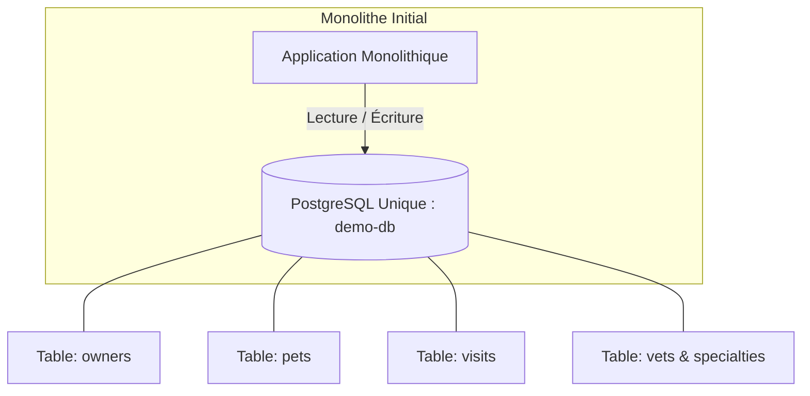
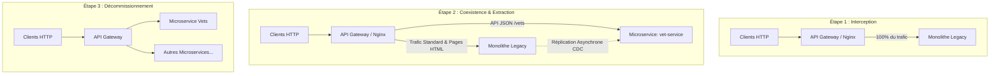
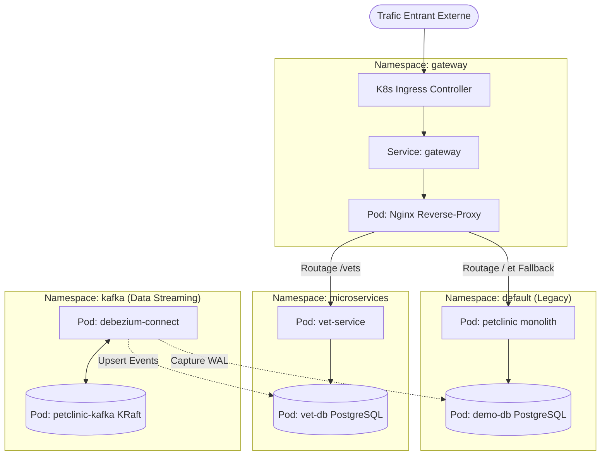
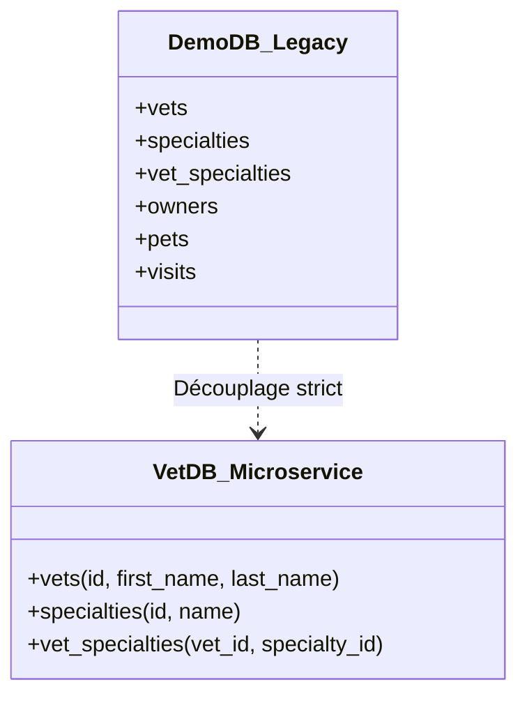
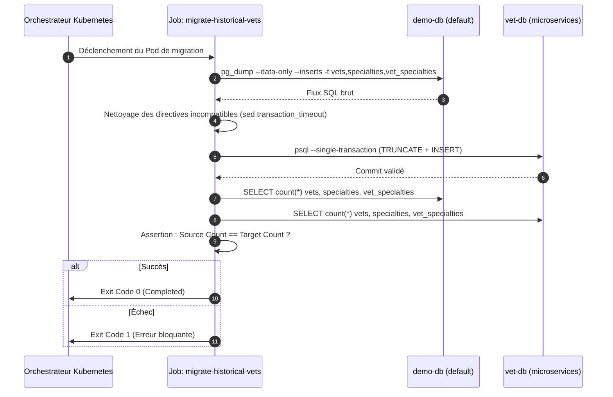
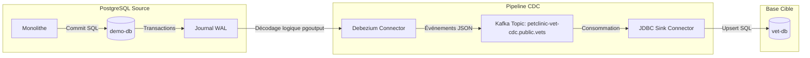

# Déconstruction et Migration d'un Monolithe : Architecture Strangler Fig, CDC et Kubernetes de Bout en Bout

> **Auteur / Dossier Technique d'Architecture Système**  
> Ce document est conçu comme un article technique approfondi décrivant de manière exhaustive la méthodologie, l'architecture d'infrastructure, le découpage des données, la gestion des flux en temps réel et les procédures d'exploitation mises en œuvre pour migrer un système monolithique vers une architecture microservices sans aucune coupure de service (**Zero Downtime**).

---

## Sommaire Analytique
1. [Introduction & Genèse du Projet](#1-introduction--genèse-du-projet)
2. [Analyse de l'État Initial & Problématique Métier](#2-analyse-de-létat-initial--problématique-métier)
3. [La Stratégie Directrice : Le Strangler Fig Pattern](#3-la-stratégie-directrice--le-strangler-fig-pattern)
4. [Architecture Réseau & Isolation sous Kubernetes](#4-architecture-réseau--isolation-sous-kubernetes)
5. [L'API Gateway (Nginx) : Le Cœur de l'Aiguillage et de la Haute Disponibilité](#5-lapi-gateway-nginx--le-cœur-de-laiguillage-et-de-la-haute-disponibilité)
6. [La Séparation des Données : Database-per-Service](#6-la-séparation-des-données--database-per-service)
7. [Phase 1 de Migration : Le Chargement des Données Historiques (Batch One-Shot)](#7-phase-1-de-migration--le-chargement-des-données-historiques-batch-one-shot)
8. [Phase 2 de Migration : Synchronisation Continue via CDC (Change Data Capture) & Apache Kafka](#8-phase-2-de-migration--synchronisation-continue-via-cdc-change-data-capture--apache-kafka)
9. [Analyse des Incidents Réels, Contraintes Opérationnelles & Optimisations](#9-analyse-des-incidents-réels-contraintes-opérationnelles--optimisations)
10. [Guide d'Exploitation et Déploiement Reproductible](#10-guide-dexploitation-et-déploiement-reproductible)
11. [Conclusion & Synthèse Comparative](#11-conclusion--synthèse-comparative)

---

## 1. Introduction & Genèse du Projet

La modernisation d'un système d'information critique fait face à une contrainte forte : **le système ne peut pas s'arrêter**. La réécriture intégrale (*Big Bang*) est le modèle qui présente le taux d'échec le plus élevé en ingénierie logicielle. Elle crée un "effet tunnel" où le produit reste figé pendant des mois, avant une bascule massive le week-end qui s'achève fréquemment en indisponibilité majeure ou en perte de données.

Ce projet prouve et met en œuvre une alternative industrielle : **la décomposition incrémentale**.
En prenant pour socle un système monolithique d'entreprise (gestion de clinique vétérinaire), nous avons extrait un domaine fonctionnel autonome — **les Vétérinaires (`vets`)** — pour le propulser sous forme de microservice indépendant (`vet-service`), tout en maintenant la coexistence harmonieuse et transparente de l'ancien et du nouveau système.

---

## 2. Analyse de l'État Initial & Problématique Métier

### Le Système Legacy
Initialement, l'ensemble des modules (propriétaires `owners`, animaux `pets`, visites médicales `visits`, et vétérinaires `vets`) réside au sein du même exécutable. 
Toutes les entités sont regroupées dans un schéma relationnel unique géré par une base PostgreSQL (`demo-db`).



### Les Problèmes du Modèle Initial
1. **Couplage Fort** : Toute modification du modèle relationnel de la table `vets` exigeait de reconstruire et redéployer l'intégralité du monolithe.
2. **Concurrence sur les Ressources** : Une requête complexe de reporting sur les vétérinaires pouvait saturer le pool de connexions et bloquer la prise de rendez-vous pour les visites.
3. **Impossibilité de scaler sélectivement** : Impossible d'allouer plus de CPU au module le plus sollicité sans démultiplier l'intégralité du monolithe.

---

## 3. La Stratégie Directrice : Le Strangler Fig Pattern

Pour transformer ce monolithe sans interruption, nous avons déployé le patron d'architecture **Strangler Fig** (Figuier Étrangleur).



### Les Trois Piliers du Strangler Fig :
1. **Intercepter** : Aucune requête client ne doit atteindre directement le backend ; tout passe par une passerelle (API Gateway).
2. **Transformer** : Le domaine isolé est redéveloppé sous forme de service autonome, avec sa propre base de données.
3. **Basculer & Étrangler** : La passerelle réoriente graduellement les requêtes vers le microservice. Lorsque plus aucune requête ne sollicite l'ancien code du domaine dans le monolithe, ce dernier peut être purgé ou désactivé.

---

## 4. Architecture Réseau & Isolation sous Kubernetes

L'infrastructure cible repose sur **Kubernetes**, architecturée en **Namespaces** étanches afin d'appliquer le principe de séparation des privilèges et de compartimentation réseau :



### Rôle des Namespaces :
- **`gateway`** : Héberge Nginx, les ConfigMaps de routage et l'Ingress. C'est la zone démilitarisée (DMZ) interne du cluster.
- **`default`** : Isole le monolithe historique et sa base source `demo-db`.
- **`microservices`** : Environnement d'accueil des nouveaux microservices autonomes et de leurs bases de données dédiées.
- **`kafka`** : Espace réservé à l'infrastructure de streaming d'événements, aux opérateurs Strimzi et aux connecteurs Kafka Connect.

---

## 5. L'API Gateway (Nginx) : Le Cœur de l'Aiguillage et de la Haute Disponibilité

La passerelle Nginx joue le rôle de pivot. Elle réalise un travail d'aiguillage contextuel tout en intégrant un filet de sécurité transparent.

### 5.1. Découpage Granulaire des Chemins d'Accès

Le défi classique d'une application web réside dans la séparation entre l'interface utilisateur et les interfaces de programmation :
- **L'API de données** (`GET /vets`) est consommée par des composants modernes ou des applications clientes : elle doit être dirigée vers `vet-service`.
- **L'interface graphique rendue côté serveur** (`GET /vets.html`) est basée sur les templates Thymeleaf du monolithe. Si l'on envoyait `/vets.html` au microservice, celui-ci renverrait une erreur 404 car il n'embarque pas les vues web legacy.

**Configuration Nginx appliquée ([k8s/gateway.yml](file:///c:/Users/chigu/projects/Migration/spring-petclinic/k8s/gateway.yml)) :**
```nginx
# Upstream principal du microservice avec le monolithe déclaré en secours immédiat
upstream vet_service_backend {
    server vet-service.microservices.svc.cluster.local:8080 max_fails=3 fail_timeout=10s;
    server petclinic.default.svc.cluster.local:80 backup;
}

upstream monolith_backend {
    server petclinic.default.svc.cluster.local:80 max_fails=3 fail_timeout=10s;
}

# Aiguille l'API REST vers le microservice
location ~ ^/vets(/|$) {
    proxy_set_header Host $http_host;
    proxy_set_header X-Real-IP $remote_addr;
    proxy_set_header X-Forwarded-For $proxy_add_x_forwarded_for;
    proxy_set_header X-Request-ID $request_id;
    
    # Sécurité Zero-Downtime : Si le microservice échoue, bascule instantanée sur le backup
    proxy_next_upstream error timeout http_502 http_503 http_504;
    proxy_pass http://vet_service_backend;
}

# Reste du trafic (y compris /vets.html et /owners) vers le monolithe
location / {
    proxy_pass http://monolith_backend;
}
```

### 5.2. Le Mécanisme de Fallback Transparent (Zero-Downtime)

La directive `server petclinic.default.svc.cluster.local:80 backup;` associée à `proxy_next_upstream` constitue la clé de voûte de la continuité d'activité :
1. Un client émet `GET /vets`.
2. Nginx initie la connexion vers `vet-service`.
3. Si le pod du microservice crash (`OOMKilled`, redémarrage, saturation ou timeout réseau) :
   - Nginx intercepte le code d'erreur HTTP 502/503/504 en interne (dans les limites du `proxy_connect_timeout`).
   - Nginx rejoue la requête **exactement identique** sur le serveur déclaré en `backup` (le monolithe).
   - Le client reçoit sa réponse 200 sans jamais constater de panne.

---

## 6. La Séparation des Données : Database-per-Service

Partager une base de données entre plusieurs microservices est l'erreur d'architecture la plus fréquente. Elle crée un couplage caché par le schéma et détruit l'autonomie des équipes.



### Déploiement de la Base Cible `vet-db`
Dans [k8s/vet-service.yml](file:///c:/Users/chigu/projects/Migration/spring-petclinic/k8s/vet-service.yml) :
- **Moteur** : PostgreSQL 16 Alpine.
- **Isolation** : Un PersistentVolumeClaim dédié (`vet-db-data`) de 2Gi indépendant du stockage legacy.
- **Initialisation Déclarative** : Un `ConfigMap` contenant le DDL SQL strict du domaine (`01-init.sql`) monté dans `/docker-entrypoint-initdb.d` pour créer les tables et index `idx_vets_last_name` et `idx_specialties_name`.

---

## 7. Phase 1 de Migration : Le Chargement des Données Historiques (Batch One-Shot)

Avant d'activer le flux temps réel, il est obligatoire d'importer le stock initial de données présent dans `demo-db` vers `vet-db`.



### Implémentation du Job Kubernetes ([k8s/migrate-historical-data-job.yml](file:///c:/Users/chigu/projects/Migration/spring-petclinic/k8s/migrate-historical-data-job.yml))

Le job repose sur trois principes d'ingénierie robustes :
1. **Extraction Ciblée & Granulaire** :
   ```bash
   pg_dump -h demo-db.default.svc.cluster.local -U user -d petclinic \
     --data-only --inserts \
     -t vets -t specialties -t vet_specialties \
     --file=/tmp/historical-vets.sql
   ```
2. **Résolution des Incompatibilités de Version** :
   La base source PostgreSQL 18 génère des instructions `SET transaction_timeout = 0;` non reconnues par la base cible PostgreSQL 16. Le job applique un filtre en mémoire :
   ```bash
   sed '/^SET transaction_timeout = /d' /tmp/historical-vets.sql > /tmp/historical-vets-pg16.sql
   ```
3. **Atomicité & Contrôle d'Intégrité Strict** :
   L'injection se fait via `--single-transaction --set=ON_ERROR_STOP=1`. Si un seul enregistrement échoue, l'intégralité de l'opération est annulée (*rollback*). À la fin, le script compare les comptages :
   ```bash
   test "$SRC_COUNTS" = "$DST_COUNTS"
   ```

---

## 8. Phase 2 de Migration : Synchronisation Continue via CDC (Change Data Capture) & Apache Kafka

Une fois l'historique importé, des écritures continuent de survenir sur le monolithe. Comment propager ces modifications vers `vet-db` sans modifier le code de l'application legacy ?

### 8.1. Le Problème Fondamental du Dual-Write

Demander à une application d'écrire dans deux bases de données simultanément est voué à l'échec en environnement distribué :
- Si l'écriture dans la base 1 réussit mais que le réseau coupe lors de l'écriture dans la base 2, les données divergent irrémédiablement.
- Les transactions distribuées (Two-Phase Commit / 2PC) créent un goulet d'étranglement inacceptable en termes de latence et de scalabilité.

### 8.2. Le Patron CDC (Change Data Capture)

La solution consiste à écouter le journal de transactions (**WAL** pour *Write-Ahead Log*) du moteur de base de données source. Toute transaction validée (*committed*) y est inscrite de manière immuable.



### 8.3. Configuration de l'Infrastructure CDC

Toute la chaîne a été construite et déployée de manière déclarative avec l'opérateur **Strimzi** ([k8s/kafka.yml](file:///c:/Users/chigu/projects/Migration/spring-petclinic/k8s/kafka.yml)) :

#### A. Préparation de la base source PostgreSQL ([k8s/db.yml](file:///c:/Users/chigu/projects/Migration/spring-petclinic/k8s/db.yml))
PostgreSQL doit être démarré avec les arguments de réplication logique activés :
```yaml
containers:
  - image: postgres:18.4
    name: postgresql
    args: 
      - "-c"
      - "wal_level=logical"
      - "-c"
      - "max_replication_slots=4"
      - "-c"
      - "max_wal_senders=4"
```

#### B. Apache Kafka en mode KRaft
Kafka est déployé sans ZooKeeper via la ressource `KafkaNodePool` :
- Architecture simplifiée à un seul broker pour limiter la consommation mémoire.
- Listener interne non chiffré sur le port 9092 pour des performances optimales à l'intérieur du réseau Kubernetes.

#### C. L'Image personnalisée Kafka Connect ([k8s/debezium-connect.Dockerfile](file:///c:/Users/chigu/projects/Migration/spring-petclinic/k8s/debezium-connect.Dockerfile))
Strimzi ne contient pas les connecteurs par défaut. Une image dérivée a été générée :
```dockerfile
FROM quay.io/strimzi/kafka:1.3.0-kafka-4.3.1
USER root:root
# Ajout du plugin Debezium PostgreSQL Connector
RUN mkdir -p /opt/kafka/plugins/debezium-postgres && ...
# Ajout du plugin Debezium JDBC Sink Connector + Driver PostgreSQL JDBC
RUN mkdir -p /opt/kafka/plugins/debezium-jdbc && ...
USER 1001
```

#### D. Le Connecteur Source Debezium
Le connecteur `petclinic-postgres-source` surveille en continu la base source :
```yaml
apiVersion: kafka.strimzi.io/v1
kind: KafkaConnector
metadata:
  name: petclinic-postgres-source
spec:
  class: io.debezium.connector.postgresql.PostgresConnector
  config:
    database.hostname: demo-db.default.svc.cluster.local
    plugin.name: pgoutput
    slot.name: debezium_petclinic
    publication.name: debezium_pub
    topic.prefix: petclinic-vet-cdc
    table.include.list: "public.vets,public.specialties,public.vet_specialties"
    # Évite de rejouer tout l'historique car le Job s'en est déjà chargé
    snapshot.mode: no_data
```

#### E. Le Connecteur JDBC Sink (Vers `vet-db`)
Le connecteur `vet-vets-sink` consomme le topic Kafka et écrit dans `vet-db` :
```yaml
apiVersion: kafka.strimzi.io/v1
kind: KafkaConnector
metadata:
  name: vet-vets-sink
spec:
  class: io.debezium.connector.jdbc.JdbcSinkConnector
  config:
    topics: petclinic-vet-cdc.public.vets
    connection.url: jdbc:postgresql://vet-db.microservices.svc.cluster.local:5432/vetdb
    insert.mode: upsert
    primary.key.mode: record_key
    primary.key.fields: id
    table.name.format: vets
```
> **Le rôle crucial du mode `upsert`** : Si un enregistrement existe déjà, il est mis à jour (`UPDATE`). S'il n'existe pas, il est inséré (`INSERT`). Cela garantit l'idempotence totale de la réplication, même en cas de rejeu d'événements.

---

## 9. Analyse des Incidents Réels, Contraintes Opérationnelles & Optimisations

La mise en œuvre sur un cluster de développement (Minikube sous Windows) a mis en lumière des problématiques de production réelles :

### 1. Gestion de la Pression Mémoire et des JVMs
* **Symptôme** : Les pods Kafka, Entity Operator et Debezium Connect ont subi des cycles de `CrashLoopBackOff` dus à des dépassements de mémoire (*OOMKilled*).
* **Cause racine** : Par défaut, la machine virtuelle Java (JVM) tente d'allouer une fraction importante de la mémoire hôte si aucune limite n'est explicitement fixée.
* **Correction appliquée** :
  - Définition stricte des options JVM `-Xms` et `-Xmx` dans les manifestes Strimzi :
    - Kafka Broker : `-Xms: 256m`, `-Xmx: 384m`
    - Kafka Connect : `-Xms: 256m`, `-Xmx: 512m`
  - Alignement des `resources.requests` et `resources.limits` Kubernetes pour éviter l'éviction par le kubelet.

### 2. Découplage "Historique" vs "CDC" (`snapshot.mode: no_data`)
* **Symptôme** : Au premier démarrage, Debezium tente par défaut d'effectuer un snapshot initial complet de la base en posant des verrous de lecture. Sur de grosses bases, ce snapshot peut saturer la mémoire et bloquer les écritures.
* **Solution retenue** : Séparation stricte des responsabilités. Le chargement initial est confié au **Job one-shot** optimisé via `pg_dump`. Debezium est configuré avec `snapshot.mode: no_data`, se concentrant uniquement sur la capture des deltas futurs.

---

## 10. Guide d'Exploitation et Déploiement Reproductible

Pour rejouer l'ensemble de cette architecture sur un cluster Kubernetes vierge :

### Étape 1 : Créer les Espaces de Noms
```bash
kubectl apply -f k8s/00-namespaces.yml
```

### Étape 2 : Déployer le Monolithe et la Base Source
```bash
kubectl apply -f k8s/db.yml
kubectl apply -f k8s/petclinic.yml
```

### Étape 3 : Déployer le Microservice et sa Base Dédiée
```bash
kubectl apply -f k8s/vet-service.yml
```

### Étape 4 : Exécuter la Migration des Données Historiques
```bash
kubectl apply -f k8s/migrate-historical-data-job.yml
# Vérifier la réussite du job
kubectl wait --for=condition=complete job/migrate-historical-vets -n default --timeout=120s
```

### Étape 5 : Déployer le Cluster Kafka et les Connecteurs CDC
```bash
kubectl apply -f k8s/kafka.yml
```

### Étape 6 : Activer la Passerelle de Routage (API Gateway)
```bash
kubectl apply -f k8s/gateway.yml
```

---

## 11. Conclusion & Synthèse Comparative

Ce projet démontre qu'une migration vers les microservices n'est pas une rupture brutale, mais une transition progressive orchestrée par des composants d'infrastructure spécialisés.

| Critère d'Évaluation | Approche Classique "Big Bang" | Notre Approche "Strangler Fig + CDC" |
| :--- | :--- | :--- |
| **Indisponibilité Utilisateur** | Heures ou jours de coupure planifiée | **Zero-Downtime** (bascule transparente à chaud) |
| **Risque d'Échec Global** | Extrêmement élevé (retour arrière difficile) | **Quasi nul** (fallback automatique sur le monolithe) |
| **Intégrité des Données** | Risque fort de désynchronisation | **Garantie** par le WAL de Postgres et les Upserts Kafka |
| **Impact sur le Code Legacy** | Refactorisation lourde et risquée | **Zéro modification de code** sur le monolithe |
| **Validation du Domaine** | Tout le système est testé d'un coup | **Validation isolée** du domaine `vets` avant d'étendre la démarche |

L'infrastructure mise en place offre un gabarit (*blueprint*) directement réutilisable pour extraire les domaines suivants (`visits`, `owners`, `pets`) selon le même standard d'excellence industrielle.
