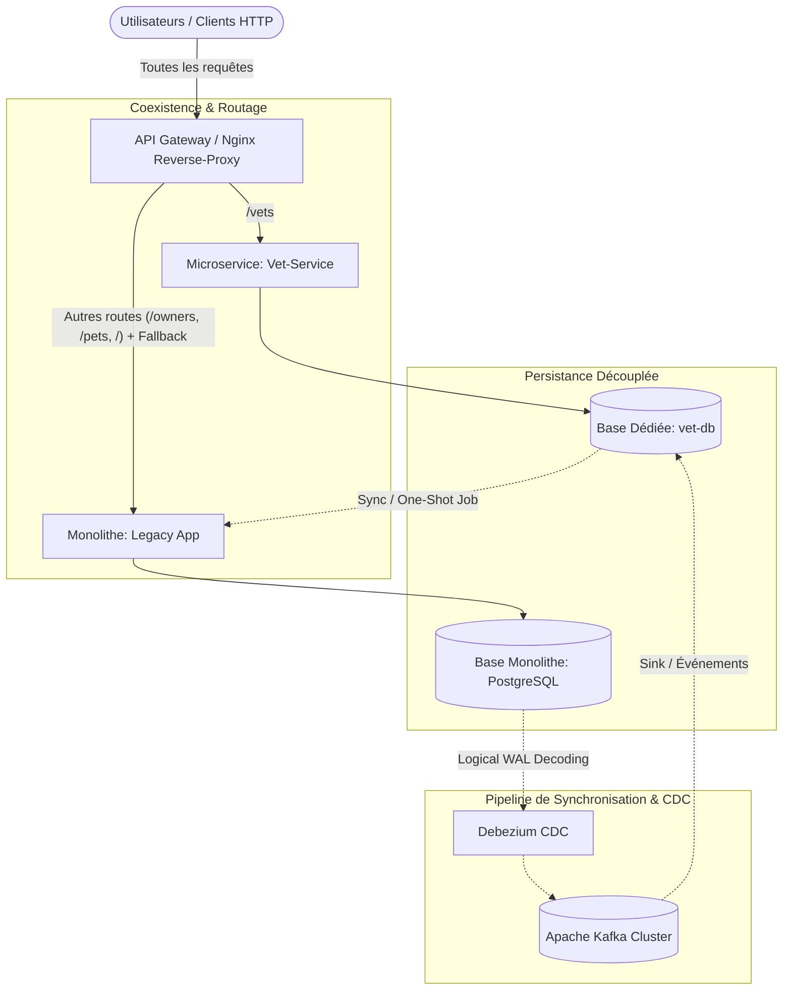
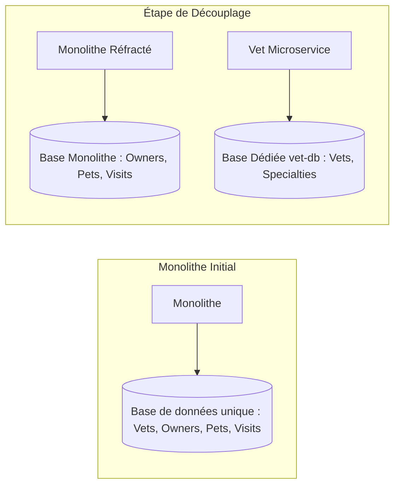
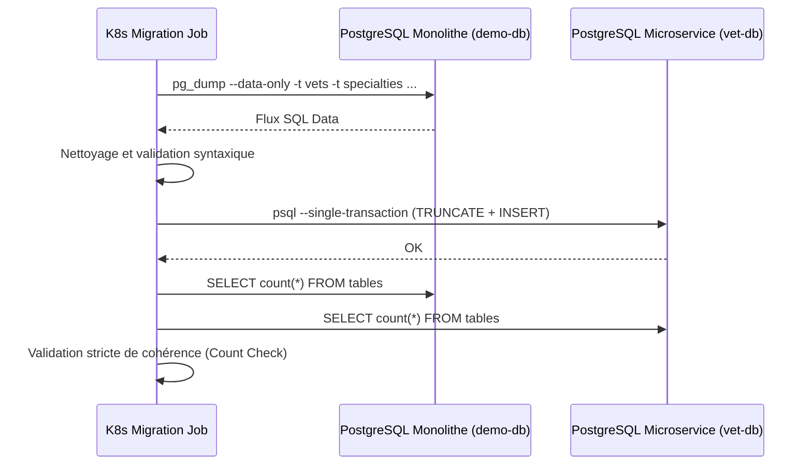
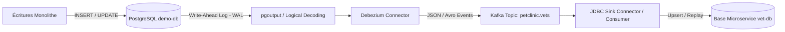
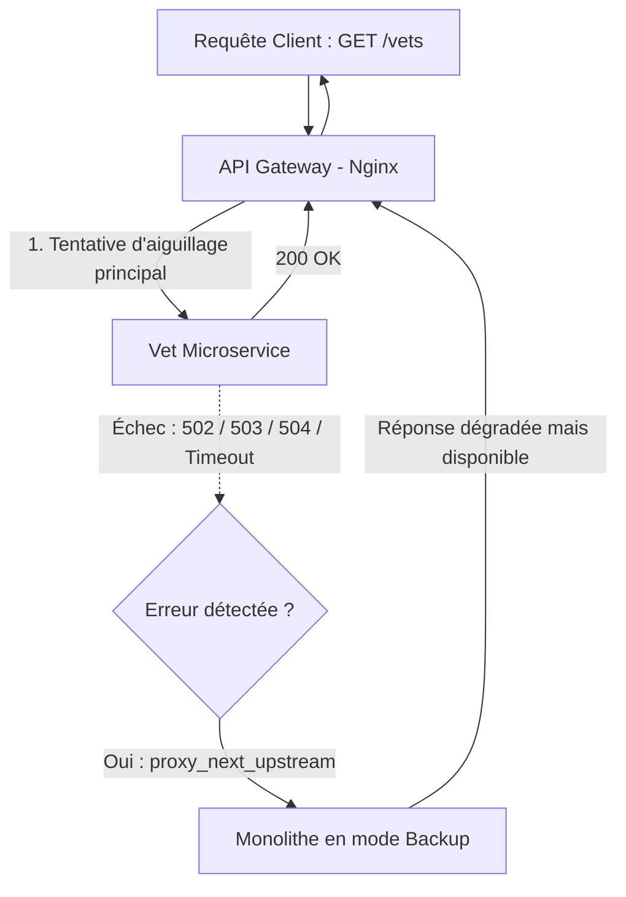
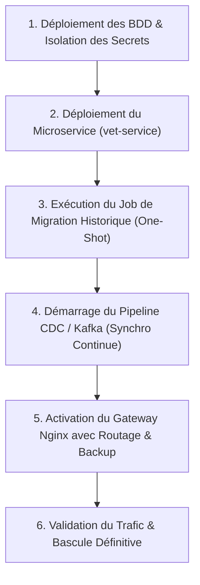

# Stratégie & Architecture de Migration Monolithe vers Microservices (Strangler Fig Pattern)

Ce document présente en détail la démarche d'ingénierie, l'architecture globale, les patrons de conception et les mécanismes de synchronisation mis en œuvre pour migrer un système monolithique vers une architecture distribuée moderne sans interruption de service (**Zero Downtime**).

> **Périmètre du document** : Ce guide ne porte pas sur le code métier applicatif de base (Spring Boot), mais se concentre exclusivement sur les **patterns d'architecture**, le **découpage des données**, la **coexistence**, la **gestion du trafic**, ainsi que la **résolution des contraintes techniques et opérationnelles**.

---

## 1. Vue d'Ensemble & Stratégie : Le Pattern "Strangler Fig"

Réécrire un monolithe d'un seul coup (effet *Big Bang*) présente un risque d'échec critique. La stratégie adoptée repose sur le pattern **Strangler Fig** (Figuier étrangleur) :
1. **Identifier un domaine borné** autonome (*Bounded Context* : ici le domaine des vétérinaires / `vet-service`).
2. **Isoler sa source de vérité** (Pattern *Database-per-Service*).
3. **Mettre en place une passerelle (API Gateway)** qui intercepte le trafic et redirige les requêtes de manière granulaire.
4. **Synchroniser les données** pour garantir la cohérence bidirectionnelle ou continue durant la phase de transition.
5. **Prévoir des mécanismes de repli (Fallback)** pour garantir une disponibilité maximale en cas de panne d'un nouveau composant.

---

## 2. Découpage des Données : Database-per-Service & Migration

L'un des défis majeurs d'une architecture microservices est la rupture du couplage au niveau de la base de données. Deux composants ne doivent jamais partager la même base transactionnelle en production.

### Étape 1 : Modélisation et Schéma Indépendant
- La base cible (`vet-db`) possède son propre schéma PostgreSQL, ses propres index et ses identifiants.
- Les dépendances relationnelles dures (clés étrangères transversales) sont supprimées ou transformées en références par identifiant logique.

### Étape 2 : Migration des Données Historiques (One-Shot Initial)
Pour initialiser la base cible avec les données existantes de la base source sans perturber le trafic :
1. **Extraction sélective** : Dump ciblé des tables du domaine (`vets`, `specialties`, `vet_specialties`).
2. **Injection transactionnelle** : Exécution dans une transaction unique (`--single-transaction`) sur la base cible pour éviter tout état incohérent en cas d'erreur.
3. **Automatisation Kubernetes (Job K8s)** : Déploiement d'un conteneur dédié (`migrate-historical-vets`) assurant le dump, l'adaptation de syntaxe (ex: compatibilité de version PostgreSQL) et la validation par calcul d'empreinte/comptage unitaire.

---

## 3. Synchronisation en Temps Réel : Change Data Capture (CDC) & Kafka

Tant que des flux résiduels écrivent sur le monolithe, les modifications doivent être répliquées en continu vers la nouvelle base sans double écriture applicative (*Dual-Write problem*).

### Principes Clés & Problèmes Résolus :
1. **Élimination du problème du double commit (Dual-Write)** :
   - *Problème* : Si l'application écrit à la fois dans sa base et publie dans Kafka, une panne réseau entre les deux opérations entraîne des désynchronisations irréversibles.
   - *Solution* : **CDC (Change Data Capture)** basé sur le WAL (*Write-Ahead Logging*) de PostgreSQL (`wal_level=logical`). L'application n'a conscience de rien ; chaque transaction validée génère un événement dans Kafka.
2. **Gestion des topologies Kafka (Strimzi vs Standalone)** :
   - Les opérateurs Kubernetes avancés (comme Strimzi avec KRaft) offrent une gestion déclarative mais peuvent induire une forte surcharge mémoire (`CrashLoopBackOff` sur des nœuds restreints).
   - *Arbitrage opérationnel* : Utilisation d'un Kafka allégé ou d'une image autonome avec connecteurs ciblés lorsque l'empreinte mémoire du cluster de test/staging est contrainte.

---

## 4. Routage Intelligent & Résilience : La Passerelle Nginx (API Gateway)

La passerelle d'accès agit comme le point d'aiguillage central du pattern Strangler. Elle protège les clients de la complexité sous-jacente.

### Mécanismes de Haute Disponibilité intégrés :
* **Découpage granulaire d'URL** :
  - `GET /vets` (API REST/JSON) est routé vers le microservice.
  - `/vets.html` (rendu côté serveur legacy) reste servi par le monolithe pour éviter de devoir redévelopper l'UI immédiatement.
* **Tolérance aux pannes active (Zero-Downtime Fallback)** :
  - Directive Nginx : `proxy_next_upstream error timeout http_502 http_503 http_504;`
  - Si le microservice est en cours de redémarrage, crashe ou subit un dépassement de capacité, le proxy renvoie **instantanément et de manière invisible** la requête vers le monolithe (`server petclinic backup;`).
* **Traçabilité distribuée** :
  - Injection automatique de l'en-tête `X-Request-ID` au niveau de la passerelle pour suivre les flux d'une extrémité à l'autre.

---

## 5. Synthèse des Problèmes Résolus et Contraintes Évitées

| Défi Technique / Risque | Approche Naïve (À Éviter) | Solution Retenue dans l'Architecture |
| :--- | :--- | :--- |
| **Indisponibilité pendant la bascule** | Arrêt de service (fenêtre de maintenance) pour migrer la base et le code. | **Strangler Fig + Ingress Routing** : Déploiement incrémental à chaud sans arrêt de service. |
| **Incohérence des données (Dual Write)** | L'application écrit en base puis émet une notification réseau (REST/MQ). | **Change Data Capture (CDC)** : Écoute passive du journal WAL de PostgreSQL via Debezium. |
| **Instabilité du nouveau service** | Tout incident sur le microservice entraîne une erreur 500 pour le client final. | **Upstream Backup transparent** : Bascule immédiate sur le monolithe en cas de 502/503/timeout. |
| **Couplage de base de données** | Deux services lisent et écrivent dans la même base via des vues ou tables partagées. | **Database-per-Service** stricte avec schémas et identifiants isolés (`demo-db` vs `vet-db`). |
| **Complexité de rollback** | Rétablir l'ancienne version nécessite un restore de sauvegarde coûteux. | **Bascule de configuration Ingress/Gateway** : Désactiver la route du microservice suffit à revenir au monolithe instantanément. |

---

## 6. Synthèse des Étapes pour Reproduire la Migration

1. **Provisionnement des socles** : Création des namespaces dédiés (`default`, `microservices`, `gateway`, `kafka`).
2. **Initialisation de la base dédiée** : Déploiement de PostgreSQL pour le domaine extrait avec son schéma initial.
3. **Migration historique (K8s Job)** : Synchronisation one-shot des tables existantes avec vérification de parité des lignes.
4. **Mise en place du flux CDC** : Configuration de la réplication logique PostgreSQL et des connecteurs d'événements.
5. **Aiguillage du trafic (Gateway)** : Mise en service du reverse-proxy avec règle d'upstream primaire et secours transparent vers le monolithe.
6. **Vérification canary & décommissionnement** : Validation progressive des métriques de requêtes avant découplage total.
