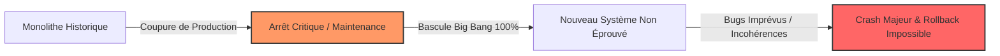
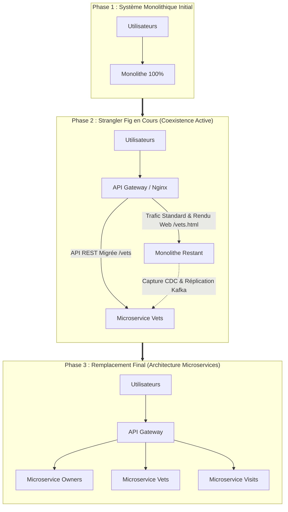
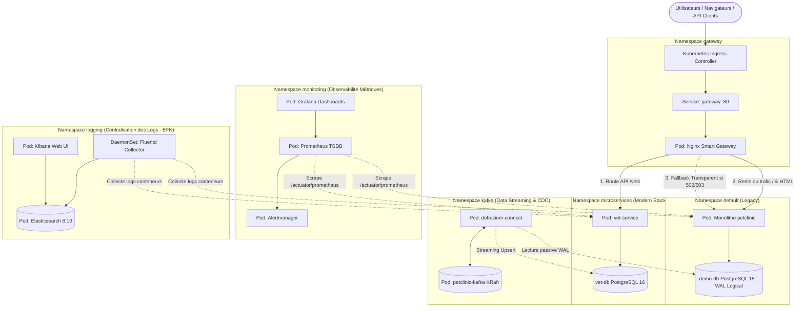
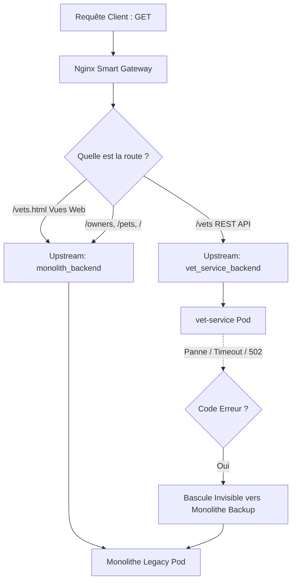
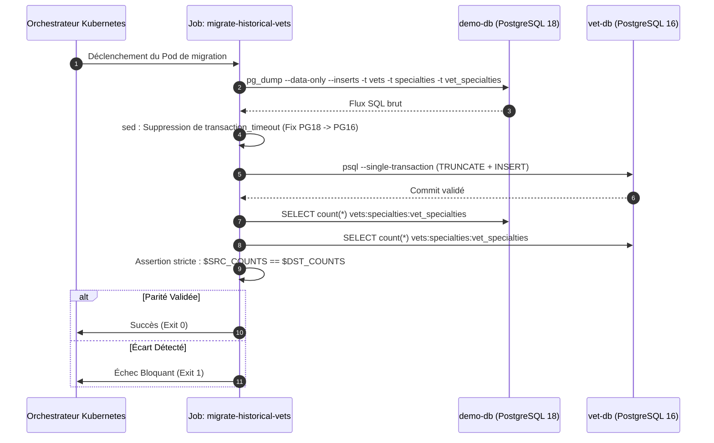
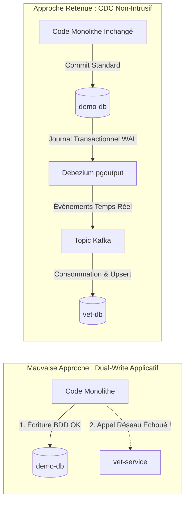
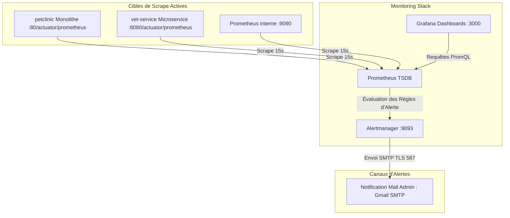

---
> **Auteur du Projet :** Abderrahmane Chiguer ([GitHub](https://github.com/abdochiguer))
>
> **Stack Technique :** Kubernetes, Spring Boot, Nginx, PostgreSQL, Debezium CDC, Apache Kafka (KRaft), Prometheus, Alertmanager, Grafana, Fluentd, Elasticsearch, Kibana
>
> **Objectif :** Migration Zero-Downtime d'un système monolithique vers les microservices via le Strangler Fig Pattern, CDC et observabilité de bout en bout.
---

# Plateforme de Migration Industrielle : Du Monolithe aux Microservices
### Strangler Fig Pattern, Change Data Capture (CDC), Réplication Kafka KRaft & Stack d'Observabilité Complète (Prometheus/Grafana/EFK) sous Kubernetes

Ce projet constitue une **implémentation réelle, complète et prête pour la production** de la décomposition progressive d'un système monolithique d'entreprise vers une architecture microservices distribuée sous **Kubernetes**, garantissant :
1. **La continuité d'activité totale (Zero-Downtime)** sans aucune coupure de service pour les utilisateurs finaux.
2. **L'intégrité et la non-régression des données** grâce au découplage de la base de données (*Database-per-Service*), une phase de chargement historique batch atomique, et un pipeline de réplication continue par **Change Data Capture (CDC)** avec Debezium et Apache Kafka.
3. **Une résilience active au niveau réseau** orchestrée par une API Gateway Nginx intelligente capable de basculer instantanément sur le monolithe en cas de panne du nouveau microservice (*Automatic Fallback*).
4. **Une observabilité de niveau entreprise** intégrant métriques applicatives/système, alertes mail intelligentes et centralisation des logs en temps réel (Prometheus, Alertmanager, Grafana, Fluentd, Elasticsearch, Kibana).

---

## Sommaire Détaillé

### [Section I : Vision Stratégique & Le Strangler Fig Pattern](#section-i--vision-stratégique--le-strangler-fig-pattern)
- [Pourquoi l'approche "Big Bang" est un piège critique](#pourquoi-lapproche-big-bang-est-un-piège-critique)
- [Le Strangler Fig Pattern expliqué chronologiquement](#le-strangler-fig-pattern-expliqué-chronologiquement)
- [Architecture Cible & Vue d'Ensemble](#architecture-cible--vue-densemble)

### [Section II : Découpage Réseau, Routage & Résilience Active](#section-ii--découpage-réseau-routage--résilience-active)
- [Topologie des Espaces de Noms (Namespaces K8s)](#topologie-des-espaces-de-noms-namespaces-k8s)
- [L'API Gateway Nginx : L'Aiguillage Intelligent](#lapi-gateway-nginx--laiguillage-intelligent)
- [Mécanisme de Secours Transparent (Fallback Zero-Downtime)](#mécanisme-de-secours-transparent-fallback-zero-downtime)

### [Section III : Découpage des Données & Pipeline de Synchronisation](#section-iii--découpage-des-données--pipeline-de-synchronisation)
- [Le Modèle Database-per-Service](#le-modèle-database-per-service)
- [Phase 1 : Migration des Données Historiques (Job Kubernetes Batch)](#phase-1--migration-des-données-historiques-job-kubernetes-batch)
- [Phase 2 : Synchronisation Continue via CDC (Debezium & Kafka KRaft)](#phase-2--synchronisation-continue-via-cdc-debezium--kafka-kraft)
  - [L'Antipattern du Dual-Write & Le Journal WAL](#lantipattern-du-dual-write--le-journal-wal)
  - [Cluster Kafka KRaft & Connecteurs Déclaratifs](#cluster-kafka-kraft--connecteurs-déclaratifs)
  - [Idempotence et Résolution des Conflits via Upsert JDBC](#idempotence-et-résolution-des-conflits-via-upsert-jdbc)

### [Section IV : Observabilité Complète : Métriques, Alertes & Centralisation des Logs](#section-iv--observabilité-complète--métriques-alertes--centralisation-des-logs)
- [Architecture de la Stack de Monitoring (Prometheus, Alertmanager & Grafana)](#architecture-de-la-stack-de-monitoring-prometheus-alertmanager--grafana)
- [Règles d'Alerte Actives & Notification Automatique](#règles-dalerte-actives--notification-automatique)
- [Architecture de la Stack de Logging (EFK : Fluentd, Elasticsearch & Kibana)](#architecture-de-la-stack-de-logging-efk--fluentd-elasticsearch--kibana)

### [Section V : Incidents Opérationnels Réels & Solutions Appliquées](#section-v--incidents-opérationnels-réels--solutions-appliquées)
- [CrashLoopBackOff & Optimisation JVM des Brokers Kafka](#crashloopbackoff--optimisation-jvm-des-brokers-kafka)
- [Incompatibilités Multi-Versions PostgreSQL (PG18 vs PG16)](#incompatibilités-multi-versions-postgresql-pg18-vs-pg16)
- [Découplage de Snapshot (snapshot.mode: no_data)](#découplage-de-snapshot-snapshotmode-no_data)

### [Section VI : Guide d'Exploitation & Cahier de Recette Postman](#section-vi--guide-dexploitation--cahier-de-recette-postman)
- [Guide de Déploiement Reproductible](#guide-de-déploiement-reproductible)
- [Validation & Cahier de Recette Postman](#validation--cahier-de-recette-postman)
- [Simulateur de Trafic Local (Canary & Load Testing)](#simulateur-de-trafic-local-canary--load-testing)

---

# Section I : Vision Stratégique & Le Strangler Fig Pattern

## Pourquoi l'approche "Big Bang" est un piège critique

Dans l'ingénierie logicielle, l'approche naïve du **Big Bang** consiste à reconstruire l'application de zéro pendant des mois, puis à couper brutalement l'ancienne production un week-end pour basculer 100% des utilisateurs sur le nouveau système.



Cette méthode échoue presque systématiquement en entreprise pour trois raisons majeures :
1. **L'Effet Tunnel** : Le produit est gelé pendant des mois ; aucune nouvelle fonctionnalité ne peut être livrée aux clients.
2. **Le Gouffre Transactionnel** : Migrer des téraoctets de données d'un coup impose une indisponibilité majeure et un risque élevé de corruption de données.
3. **L'Impossibilité de Rollback** : Si le nouveau système présente un bug latent sous forte charge, revenir en arrière est quasiment impossible.

---

## Le Strangler Fig Pattern expliqué chronologiquement

Pour neutraliser ces risques, nous appliquons le **Strangler Fig Pattern** (Figuier Étrangleur). Inspiré de la plante tropicale qui s'enroule autour d'un arbre hôte pour s'y substituer sans créer de vide, ce pattern permet de remplacer le monolithe **brique par brique**, de façon fluide et imperceptible pour l'utilisateur.



### La Démarche Méthodologique Appliquée :
1. **Identifier le Domaine Pilote** : Le domaine des **Vétérinaires (`vets`)** a été extrait en premier car son périmètre relationnel est bien délimité, permettant de roder le pipeline d'infrastructure sans risque pour le cœur de métier transactionnel.
2. **Placer un Routeur d'Interception (API Gateway)** : Toutes les requêtes arrivent sur une passerelle Nginx qui décide du routage.
3. **Séparer la Base de Données** : Déploiement d'une base dédiée (`vet-db`), initialisée avec les données historiques.
4. **Répliquer en Continu sans Toucher au Code** : Capture des deltas via CDC et Kafka pour garantir la fraîcheur des données.
5. **Aiguiller et Sécuriser** : Bascule de la route vers le microservice, protégée par un mécanisme de secours immédiat en cas d'incident.

---

## Architecture Cible & Vue d'Ensemble

L'infrastructure cible déploie l'ensemble des couches logicielles, d'ingénierie de données et d'observabilité sous Kubernetes :



---

# Section II : Découpage Réseau, Routage & Résilience Active

## Topologie des Espaces de Noms (Namespaces K8s)

Pour empêcher tout couplage direct et faire respecter le principe de défense en profondeur, l'infrastructure est segmentée en 5 espaces de noms isolés ([k8s/00-namespaces.yml](file:///c:/Users/chigu/projects/Migration/spring-petclinic/k8s/00-namespaces.yml)) :

| Namespace | Vocation Opérationnelle | Composants Principaux |
| :--- | :--- | :--- |
| **`gateway`** | Périmètre d'entrée réseau, filtrage et sécurisation | Nginx Ingress, Pod Nginx Reverse-Proxy, ConfigMaps de routage |
| **`default`** | Environnement d'hébergement du système legacy | Monolithe Spring PetClinic, Base source `demo-db` (Postgres 18) |
| **`microservices`** | Environnement des microservices découplés | `vet-service` (REST API), Base dédiée `vet-db` (Postgres 16) |
| **`kafka`** | Pipeline d'ingestion et réplication de données | Cluster Kafka KRaft, Debezium Connect, Connecteurs CDC |
| **`monitoring`** | Surveillance des métriques et alertes | Prometheus, Alertmanager, Grafana, Alertes Gmail |
| **`logging`** | Collecte et analyse centralisée des logs | DaemonSet Fluentd, Elasticsearch 8.10, Kibana |

---

## L'API Gateway Nginx : L'Aiguillage Intelligent

L'API Gateway joue le rôle de point de contrôle unique. Elle découpe finement les accès afin de ne pas perturber l'expérience utilisateur :



### Configuration Réelle Appliquée ([k8s/gateway.yml](file:///c:/Users/chigu/projects/Migration/spring-petclinic/k8s/gateway.yml)) :
```nginx
upstream vet_service_backend {
    server vet-service.microservices.svc.cluster.local:8080 max_fails=3 fail_timeout=10s;
    server petclinic.default.svc.cluster.local:80 backup; # <-- Le Monolithe en sauvegarde immédiate
}

upstream monolith_backend {
    server petclinic.default.svc.cluster.local:80 max_fails=3 fail_timeout=10s;
}

server {
    listen 8080;

    location = /healthz {
        return 200 'ok';
        add_header Content-Type text/plain;
    }

    # Route l'API REST JSON vers le microservice
    location ~ ^/vets(/|$) {
        proxy_set_header Host $http_host;
        proxy_set_header X-Real-IP $remote_addr;
        proxy_set_header X-Forwarded-For $proxy_add_x_forwarded_for;
        proxy_set_header X-Request-ID $request_id;
        proxy_connect_timeout 10s;
        proxy_read_timeout 30s;

        # Sécurité Zero-Downtime : Si le microservice échoue, bascule instantanée sur le backup
        proxy_next_upstream error timeout http_502 http_503 http_504;
        proxy_pass http://vet_service_backend;
        proxy_redirect off;
    }

    # Toutes les autres requêtes (y compris la page HTML /vets.html) restent sur le monolithe
    location / {
        proxy_set_header Host $http_host;
        proxy_set_header X-Real-IP $remote_addr;
        proxy_set_header X-Forwarded-For $proxy_add_x_forwarded_for;
        proxy_set_header X-Request-ID $request_id;
        proxy_pass http://monolith_backend;
    }
}
```

---

## Mécanisme de Secours Transparent (Fallback Zero-Downtime)

La combinaison de `server petclinic.default.svc.cluster.local:80 backup;` et de `proxy_next_upstream error timeout http_502 http_503 http_504;` supprime totalement le risque de déploiement :
1. Un client envoie une requête `GET /vets`.
2. Nginx l'achemine vers le pod `vet-service`.
3. Si le pod du microservice redémarre, sature ou subit une rupture de mémoire (502/503) :
   - Nginx intercepte l'erreur instantanément en interne.
   - La requête est immédiatement réémise vers le monolithe historique en mode `backup`.
   - **Le client final reçoit une réponse HTTP 200 valide sans jamais s'apercevoir de l'incident.**

---

# Section III : Découpage des Données & Pipeline de Synchronisation

## Le Modèle Database-per-Service

Partager une base de données entre services crée un fort couplage structurel. Pour y remédier, le microservice dispose de sa propre base PostgreSQL 16 Alpine (`vet-db`), avec son propre volume persistant (`vet-db-data`) et son initialisation déclarative par ConfigMap ([k8s/vet-service.yml](file:///c:/Users/chigu/projects/Migration/spring-petclinic/k8s/vet-service.yml)).

---

## Phase 1 : Migration des Données Historiques (Job Kubernetes Batch)

Pour injecter les données existantes de la base source vers la nouvelle base sans intervention manuelle risquée, un Job Kubernetes dédié a été conçu ([k8s/migrate-historical-data-job.yml](file:///c:/Users/chigu/projects/Migration/spring-petclinic/k8s/migrate-historical-data-job.yml)).



### Détail Technique du Script :
- **Extraction Ciblée** : `pg_dump` extrait uniquement les tables du domaine (`vets`, `specialties`, `vet_specialties`).
- **Correction Multi-Versions** : Suppression via `sed` de la directive `SET transaction_timeout = 0;` (spécifique à PostgreSQL 18 et non supportée par PostgreSQL 16).
- **Atomicité Transactionnelle** : L'injection utilise `--single-transaction --set=ON_ERROR_STOP=1`. En cas de panne au milieu de l'import, tout est annulé proprement.
- **Assertion de Contrôle** : Le script compare les comptages exacts entre la source et la cible avant de valider l'exécution (`test "$SRC_COUNTS" = "$DST_COUNTS"`).

---

## Phase 2 : Synchronisation Continue via CDC (Debezium & Kafka KRaft)

### L'Antipattern du Dual-Write & Le Journal WAL



Tenter d'écrire en même temps dans deux bases de données depuis le code applicatif (*Dual-Write*) crée des risques permanents d'incohérence en cas de timeout réseau.

**Notre Solution : Le Change Data Capture (CDC)**  
La base source PostgreSQL est configurée avec `wal_level=logical`. Toute transaction validée est inscrite dans son journal physique **WAL** (*Write-Ahead Log*). Le connecteur **Debezium** lit passivement ce journal sans surcharger la base et sans toucher à une seule ligne de code du monolithe.

### Cluster Kafka KRaft & Connecteurs Déclaratifs

Le cluster de streaming est déployé via l'opérateur **Strimzi** en mode **KRaft** (sans ZooKeeper), optimisant l'usage mémoire et garantissant une haute fiabilité ([k8s/kafka.yml](file:///c:/Users/chigu/projects/Migration/spring-petclinic/k8s/kafka.yml)).

Une image personnalisée Kafka Connect a été compilée ([k8s/debezium-connect.Dockerfile](file:///c:/Users/chigu/projects/Migration/spring-petclinic/k8s/debezium-connect.Dockerfile)) pour intégrer les plugins **Debezium PostgreSQL** et **Debezium JDBC Sink**.

### Idempotence et Résolution des Conflits via Upsert JDBC

Le connecteur cible `vet-vets-sink` consomme les messages du topic Kafka `petclinic-vet-cdc.public.vets` et applique les modifications dans la base `vet-db` avec la configuration suivante :
- `insert.mode: upsert`
- `primary.key.mode: record_key`
- `primary.key.fields: id`

> **Pourquoi le mode `upsert` est capital ?**  
> Si un message est consommé deux fois (rejeu réseau, crash de pod ou redémarrage de connecteur), l'opération met à jour la ligne existante au lieu de générer une erreur de clé dupliquée. Le système est **100% idempotent**.

---

# Section IV : Observabilité Complète : Métriques, Alertes & Centralisation des Logs

Une migration en production sans visibilité opérationnelle est aveugle. Nous avons déployé une architecture d'observabilité complète regroupant métriques et logs.

## Architecture de la Stack de Monitoring (Prometheus, Alertmanager & Grafana)

Le namespace `monitoring` regroupe l'ensemble des outils de surveillance des performances ([k8s/monitoring-stack.yml](file:///c:/Users/chigu/projects/Migration/spring-petclinic/k8s/monitoring-stack.yml)) :



- **Prometheus (v2.55.1)** : Scrape à intervalle de 15 secondes les endpoints Spring Boot Actuator (`/actuator/prometheus`) du monolithe et du microservice. Les données sont conservées sur un PersistentVolumeClaim de 2Gi.
- **Grafana (v11.4.0)** : Tableaux de bord de visualisation connectés à la source de données Prometheus configurée automatiquement via ConfigMap.
- **Alertmanager (v0.27.0)** : Routeur d'alertes configuré avec gestion de groupement (`group_wait: 10s`), déduplication et routage sécurisé.

---

## Règles d'Alerte Actives & Notification Automatique

Trois règles d'alerte critiques ont été configurées dans Prometheus ([k8s/monitoring-stack.yml](file:///c:/Users/chigu/projects/Migration/spring-petclinic/k8s/monitoring-stack.yml)) :

1. **`ServiceDown` (Sévérité : Critical)** :
   - Déclenchement : `up == 0` pendant plus de 1 minute.
   - Action : Détecte immédiatement si `vet-service` ou `petclinic` ne répond plus au scrape.
2. **`HighHttp5xxRate` (Sévérité : Warning)** :
   - Déclenchement : Taux d'erreurs HTTP 5xx supérieur à 5% sur une fenêtre de 2 minutes (`http_server_requests_seconds_count{status=~"5.."}`).
   - Action : Alerte l'équipe avant que les utilisateurs ne perçoivent une dégradation globale.
3. **`PodFrequentRestarts` (Sévérité : Critical)** :
   - Déclenchement : `increase(kube_pod_container_status_restarts_total[15m]) > 3`.
   - Action : Signale les pods pris dans une boucle de redémarrage (*CrashLoopBackOff*).

**Intégration Notifications Gmail :**  
Alertmanager est relié au serveur SMTP Gmail (`smtp.gmail.com:587`) avec authentification TLS sécurisée par Secret Kubernetes (`alertmanager-smtp-secret`), envoyant un email formaté dès le franchissement d'un seuil critique.

---

## Architecture de la Stack de Logging (EFK : Fluentd, Elasticsearch & Kibana)

Pour analyser les traces d'erreurs et corréler les logs entre le monolithe et le microservice, une stack **EFK** complète est déployée dans le namespace `logging` ([k8s/logging.yml](file:///c:/Users/chigu/projects/Migration/spring-petclinic/k8s/logging.yml)) :

```mermaid
flowchart LR
    subgraph Nœuds Kubernetes
        AppLogs[/var/log/containers/*.log]
    end

    subgraph DaemonSet Logging
        Fluentd[Fluentd Pod sur chaque Nœud]
    end

    subgraph Analyse & Stockage
        Elasticsearch[(Elasticsearch 8.10 : Single-Node)]
        Kibana[Kibana Web UI : Port 5601]
    end

    AppLogs -->|Tail en continu| Fluentd
    Fluentd -->|Enrichissement Métadonnées K8s| Fluentd
    Fluentd -->|Indexation JSON| Elasticsearch
    Kibana -->|Visualisation & Recherche| Elasticsearch
```

- **Fluentd DaemonSet (v1.20)** : S'exécute sur chaque nœud du cluster, lit les fichiers de logs conteneurs (`/var/log/containers/*.log`), filtre les entrées, enrichit les enregistrements avec les métadonnées Kubernetes (namespace, pod_name, container_name) et les transmet en continu à Elasticsearch.
- **Elasticsearch (v8.10.2)** : Moteur d'indexation et de recherche distribué, configuré avec stockage persistant (`elasticsearch-data`) et allocation mémoire JVM maîtrisée (`-Xms512m -Xmx512m`).
- **Kibana (v8.10.2)** : Interface d'exploration visuelle permettant de filtrer les flux par `kubernetes.namespace_name: "microservices"` ou `kubernetes.pod_name: "vet-service"`.

---

# Section V : Incidents Opérationnels Réels & Solutions Appliquées

La mise en œuvre pratique sur un environnement Kubernetes contraint a révélé des défis industriels majeurs qui ont été résolus et documentés :

### 1. CrashLoopBackOff & Optimisation JVM des Brokers Kafka
* **Problème** : Les pods Kafka KRaft et Debezium Connect redémarraient avec l'erreur `Exit Code 137 (OOMKilled)`.
* **Cause** : Par défaut sur conteneur Linux, la JVM réserve une part trop importante de la RAM disponible sur l'hôte, dépassant les limites imposées par Kubernetes.
* **Solution Appliquée** : Bridage explicite des options JVM dans les manifestes Strimzi :
  - Kafka Broker : `-Xms: 256m`, `-Xmx: 384m`
  - Kafka Connect : `-Xms: 256m`, `-Xmx: 512m`
  - Elasticsearch : `-Xms512m -Xmx512m`
  - Ajustement des sondes de liveness avec des délais initiaux tolérants (`initialDelaySeconds: 180`).

### 2. Incompatibilités Multi-Versions PostgreSQL (PG18 vs PG16)
* **Problème** : L'importation des dumps de `demo-db` (Postgres 18.4) échouait sur `vet-db` (Postgres 16 Alpine) avec l'erreur `unrecognized configuration parameter "transaction_timeout"`.
* **Solution Appliquée** : Intégration d'un filtre `sed` dans le Job de migration pour purger l'instruction incompatible avant l'exécution du script `psql`.

### 3. Découplage de Snapshot (`snapshot.mode: no_data`)
* **Problème** : Au démarrage, Debezium pose des verrous de lecture partagés pour copier la base, risquant de saturer la mémoire et de bloquer les écritures du monolithe.
* **Solution Appliquée** : Attribution exclusive de l'historique au **Job Kubernetes batch**, et configuration de Debezium avec `snapshot.mode: no_data` pour démarrer directement en streaming passif sur le WAL.

---

# Section VI : Guide d'Exploitation & Cahier de Recette Postman

## Guide de Déploiement Reproductible

Suivez cet ordre séquentiel pour déployer l'intégralité de la plateforme sur un cluster Kubernetes vierge :

```bash
# 1. Création des 5 Namespaces étanches
kubectl apply -f k8s/00-namespaces.yml

# 2. Déploiement du Monolithe Legacy et de la BDD Source
kubectl apply -f k8s/db.yml
kubectl apply -f k8s/petclinic.yml
kubectl wait --for=condition=ready pod -l app=demo-db -n default --timeout=120s

# 3. Déploiement du Microservice et de sa BDD Dédiée
kubectl apply -f k8s/vet-service.yml
kubectl wait --for=condition=ready pod -l app=vet-db -n microservices --timeout=120s

# 4. Exécution du Job Batch de Migration Historique
kubectl apply -f k8s/migrate-historical-data-job.yml
kubectl wait --for=condition=complete job/migrate-historical-vets -n default --timeout=180s

# 5. Déploiement du Pipeline CDC & Kafka KRaft
kubectl apply -f k8s/kafka.yml

# 6. Déploiement des Stacks d'Observabilité (Monitoring & Logging)
kubectl apply -f k8s/monitoring-stack.yml
kubectl apply -f k8s/logging.yml

# 7. Activation de l'API Gateway Nginx
kubectl apply -f k8s/gateway.yml
kubectl wait --for=condition=ready pod -l app=gateway -n gateway --timeout=90s
```

---

## Validation & Cahier de Recette Postman

Pour tester et démontrer l'architecture, ouvrez un accès local vers la Gateway :

```powershell
kubectl port-forward -n gateway svc/gateway 8080:80
```

### 1. Test de Santé de la Gateway
* **Méthode** : `GET`
* **URL** : `http://localhost:8080/healthz`
* **Résultat Attendu** : `200 OK` avec le corps texte `ok`.

### 2. Validation de l'API Migrée (`vet-service`)
* **Méthode** : `GET`
* **URL** : `http://localhost:8080/vets`
* **Headers** : `Accept: application/json`
* **Résultat Attendu** : `200 OK` avec la liste JSON des vétérinaires retournée depuis `vet-db`.

### 3. Validation de la Non-Régression du Monolithe
* **Requête API** : `GET http://localhost:8080/owners` (Servie par le monolithe).
* **Requête Vue Web** : `GET http://localhost:8080/vets.html` (Page Thymeleaf servie par le monolithe).

### 4. Crash-Test de Résilience Zéro-Downtime
Pour démontrer la bascule automatique invisible :
1. Provoquez la panne du microservice :
   ```bash
   kubectl scale deployment vet-service -n microservices --replicas=0
   ```
2. Réexécutez immédiatement la requête `GET http://localhost:8080/vets` dans Postman :
   - **Résultat** : Toujours `200 OK` ! Nginx a intercepté l'absence de pod et a basculé instantanément sur le monolithe en `backup`.
3. Restaurez le microservice :
   ```bash
   kubectl scale deployment vet-service -n microservices --replicas=1
   ```

---

## Simulateur de Trafic Local (Canary & Load Testing)

Pour simuler une charge utilisateur continue et observer les métriques dans Prometheus et Grafana, exécutez le script PowerShell fourni ([scripts/simulate-traffic.ps1](file:///c:/Users/chigu/projects/Migration/spring-petclinic/scripts/simulate-traffic.ps1)) :

```powershell
# Simulation de trafic à 4 requêtes/seconde
.\scripts\simulate-traffic.ps1 -BaseUrl "http://localhost:8080" -DelayMs 250
```

---

<div align="center">

**Ce projet démontre qu'une migration vers les microservices peut être exécutée de manière méthodique, sans risque de perte de données et avec une résilience totale face aux pannes.**

</div>
